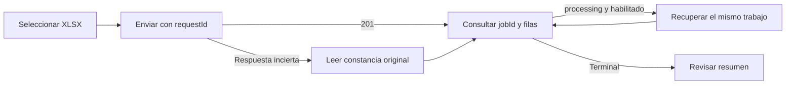

# Catálogo

Productos es Owner (`frontend/src/features/catalog/ProductsPage.tsx:32–49`); POS usa contratos de sucursal y la búsqueda devuelve coincidencias y alternativas, no sustitución clínica. `CatalogEndpoints.cs:18–76` separa mantenimiento paginado, consultas operativas y corrección auditada. Lecturas y mutaciones privadas atraviesan `TenantEndpoints.cs:15–19`. Los contratos de administración y operación comparten autenticación y aplican permisos diferentes.

## UC-CAT-01

GET `/api/tenants/{tenantId}/branches/{branchId}/operational-products` · `backend/src/MediPOS.Api/Tenant/CatalogEndpoints.cs:18`. **E1 · IMPLEMENTADO · NOT_RUN**. En POS abrir catálogo. Catálogo operativo de sucursal recibe filtros de consulta. OperationalCatalogQueries.cs:12–17 valida ProductSearch en la sede antes y después de leer; OperationalCatalogReader.cs:9–19 filtra productos activos por tenant, término/categoría y pagina. La respuesta sirve la grilla operativa sin escritura. Requisito FR-CAT-001.

## UC-CAT-02

GET `/api/tenants/{tenantId}/branches/{branchId}/operational-categories` · `backend/src/MediPOS.Api/Tenant/CatalogEndpoints.cs:21`. **E1 · IMPLEMENTADO · NOT_RUN**. En POS elegir categoría. Consulta de directorio operacional paginada. OperationalCatalogQueries.cs:20–25 verifica ProductSearch y pagina categorías. CatalogDirectoryReader.cs:11–13 lee categorías activas; datos de referencia compartidos. La UI usa el resultado como selector. Requisito FR-CAT-001.

## UC-CAT-03

PUT `/api/tenants/{tenantId}/products/{productId}/local-data` · `backend/src/MediPOS.Api/Tenant/CatalogEndpoints.cs:24`. **E1 · IMPLEMENTADO · NOT_RUN**. Editar datos locales desde ficha y guardar con revisión observada. ProductDetailPanel/EditLocalProduct → UpdateLocalProductHandler.cs:16–32 verifica revisión bloqueada y registra before/after. BusinessProductStore.cs:62,79 bloquea business_products con xmin y persiste auditoría. Global y snapshots quedan fuera del payload; recuperación UC-CAT-21.

## UC-CAT-04

GET `/api/tenants/{tenantId}/categories` · `backend/src/MediPOS.Api/Tenant/CatalogEndpoints.cs:29`. **E1 · IMPLEMENTADO · NOT_RUN**. Cargar categorías en selector de alta/filtro. ProductsPage.tsx:50–58 pagina la consulta. CatalogDirectoryQueries.cs:17–18,32–37 exige Administración antes/después. CatalogDirectoryReader.cs:11–13 proyecta activas paginadas; el selector no modifica datos. Requisito FR-CAT-001.

## UC-CAT-05

GET `/api/tenants/{tenantId}/global-products` · `backend/src/MediPOS.Api/Tenant/CatalogEndpoints.cs:31`. **E1 · IMPLEMENTADO · NOT_RUN**. Abrir Catálogo global y consultar página. API offset/limit; asociación se escribe por separado. CatalogDirectoryQueries.cs:19–20,32–37 exige Administración. CatalogDirectoryReader.cs:14–16 proyecta referencia global paginada, sin precios ni stock tenant. La asociación es UC-CAT-10. Requisito FR-CAT-001.

## UC-CAT-06

GET `/api/tenants/{tenantId}/products` · `backend/src/MediPOS.Api/Tenant/CatalogEndpoints.cs:33`. **E1 · IMPLEMENTADO · NOT_RUN**. Abrir Mis productos y filtrar página cargada. ProductsPage.tsx:48–62 filtra la página privada obtenida por offset/límite. CatalogDirectoryQueries.cs:21–22,32–37 autoriza Administración; CatalogDirectoryReader.cs:17–22 limita negocio por tenant y pagina. El filtro local conserva inactivos si están en la página. Requisito FR-CAT-001. Indicio F-003.

## UC-CAT-07

GET `/api/tenants/{tenantId}/branches/{branchId}/products/{productId}` · `backend/src/MediPOS.Api/Tenant/CatalogEndpoints.cs:35`. **E1 · IMPLEMENTADO · NOT_RUN**. Abrir ficha de producto y sus presentaciones. ProductLookup y ProductsPage comparten clave scoped catalog-detail. CatalogDirectoryQueries.cs:23–29 valida ProductSearch por sede y vuelve a autorizar. CatalogDirectoryReader.cs:24 y siguientes proyecta producto y unidades por tenant y producto. UI vuelve al acuse/detalle scoped. Requisito FR-CAT-006.

## UC-CAT-08

GET `/api/tenants/{tenantId}/branches/{branchId}/products/search` · `backend/src/MediPOS.Api/Tenant/CatalogEndpoints.cs:40`. **E1 · IMPLEMENTADO · NOT_RUN**. En POS o Inventario, escribe nombre, código o ingrediente y elige un resultado; el stock mostrado pertenece a la sede seleccionada. InlineProductLookup y SearchProductsHandler.cs:17–43 autorizan ProductSearch antes y después de leer. ProductSearchStore.cs:33–112,138–204 aplica normalización SQL, coincidencia exacta/textual y pg_trgm, productos activos por tenant, stock vendible por lote/sede, límite y orden estable. Devuelve coincidencias, composición farmacéutica en sede y disponibilidad en otras sedes admitidas. La consulta no cambia stock ni acredita equivalencia terapéutica. FR-POS-002, FR-POS-003.

## UC-CAT-09

POST `/api/tenants/{tenantId}/products/local` · `backend/src/MediPOS.Api/Tenant/CatalogEndpoints.cs:43`. **E1 · IMPLEMENTADO · NOT_RUN**. Como Owner, abre Nuevo producto, completa datos locales y guarda. CatalogEndpoints.cs:43–48 recibe LocalProductRequest. CreateLocalBusinessProductHandler.cs:15–48 verifica administración/licencia y categoría, construye datos de negocio y agrega producto y auditoría por BusinessProductStore; 201 devuelve identificador. Si se pierde respuesta, useCatalogWrite.ts:46–82 conserva intención/código para contrastar con ficha, sin repetir alta.

## UC-CAT-10

POST `/api/tenants/{tenantId}/products/from-global` · `backend/src/MediPOS.Api/Tenant/CatalogEndpoints.cs:49`. **E1 · IMPLEMENTADO · NOT_RUN**. En Catálogo global, selecciona referencia, ingresa código y precios, y confirma. CatalogEndpoints.cs:49–53 recibe GlobalProductRequest. CreateBusinessProductFromGlobalHandler.cs:14–43 valida alcance y licencia, carga referencia global y persiste vínculo local y auditoría mediante BusinessProductStore. 201 devuelve producto del tenant, sin disponibilidad de inventario implícita. Conciliación UC-CAT-21.

## UC-CAT-11

PUT `/api/tenants/{tenantId}/products/{productId}/prices` · `backend/src/MediPOS.Api/Tenant/CatalogEndpoints.cs:54`. **E1 · IMPLEMENTADO · NOT_RUN**. Desde la ficha, guarda precios minorista y mayorista opcional. CatalogEndpoints.cs:54–58 y UpdateBusinessProductPricesHandler.cs:12–41 validan administración/licencia y actualizan el BusinessProduct local con auditoría en BusinessProductStore.cs:79. El DTO devuelve el producto actualizado. Si falta respuesta verifica la ficha original (UC-CAT-21).

## UC-CAT-12

PUT `/api/tenants/{tenantId}/products/{productId}/status` · `backend/src/MediPOS.Api/Tenant/CatalogEndpoints.cs:59`. **E1 · IMPLEMENTADO · NOT_RUN**. Desde la ficha, cambia disponibilidad del producto. SetBusinessProductStatusHandler.cs:12–38 valida administración/licencia y aplica IsActive en BusinessProductStore.cs:79 con auditoría si cambia. El resultado mantiene el ID y los datos históricos. POS filtra inactivos; consulta la ficha tras una respuesta ambigua.

## UC-CAT-13

GET `/api/tenants/{tenantId}/products/{productId}/unit-configuration` · `backend/src/MediPOS.Api/Tenant/CatalogEndpoints.cs:64`. **E1 · IMPLEMENTADO · NOT_RUN**. Abre Presentaciones. ProductDetailPanel.tsx:64–86 consulta configuración del producto seleccionado. ProductUnitConfigurationHandler.cs:17–33 exige administración y ProductUnitConfigurationStore.cs:13–21 proyecta unidades y versión xmin por tenant/producto. La versión se conserva para guardar UC-CAT-14; ante lectura fallida se consulta el mismo producto.

## UC-CAT-14

PUT `/api/tenants/{tenantId}/products/{productId}/unit-configuration` · `backend/src/MediPOS.Api/Tenant/CatalogEndpoints.cs:67`. **E1 · IMPLEMENTADO · NOT_RUN**. Edita presentaciones y guarda la versión obtenida al abrir. ProductUnitConfigurationHandler.cs:38–63 autoriza administración, contrasta estado y referencias de unidades; ProductUnitConfigurationStore.cs:23–61 bloquea el producto por tenant, condiciona UPDATE al xmin esperado, persiste unidades y auditoría y devuelve nueva versión. Ante conflicto o pérdida de respuesta, recarga configuración antes de repetir.

## UC-CAT-15

PUT `/api/tenants/{tenantId}/products/{productId}/units` · `backend/src/MediPOS.Api/Tenant/CatalogEndpoints.cs:72`. **E1 · NO_EXPUESTO · NOT_RUN**. Cliente compat.: envía lista de unidades para un producto existente. CatalogEndpoints.cs:72–76 y ReplaceProductUnitsHandler.cs:42 y siguientes validan administración/licencia y reglas de reemplazo, con guardado/auditoría de unidades. La ruta no recibe ExpectedVersion; el editor actual usa UC-CAT-14. El cliente puede verificar unidades en la ficha original.

## UC-CAT-16

GET `/api/tenants/{tenantId}/product-imports/template` · `backend/src/MediPOS.Api/Tenant/ImportEndpoints.cs:11`. **E1 · IMPLEMENTADO · NOT_RUN**. En Importación pulsa Descargar plantilla. ImportPage.tsx:101–106 descarga blob; ImportEndpoints.cs:11–15 llama GenerateTenantProductImportTemplateHandler, que comprueba administración y genera XLSX. No modifica productos ni crea trabajo; la descarga puede volver a solicitarse.

## UC-CAT-17

POST `/api/tenants/{tenantId}/product-imports` · `backend/src/MediPOS.Api/Tenant/ImportEndpoints.cs:16`. **E1 · IMPLEMENTADO · NOT_RUN**. Selecciona XLSX y pulsa Importar. ImportPage.tsx:58–69 conserva requestId; ImportEndpoints.cs:16–28 limita tamaño y tipo y registra RecoverableWriteFilter. ImportProductsFromExcelHandler valida administración y filas; ProductImportStore.cs:124–221 mantiene lease y persiste resultados/producto/auditoría por fila, reautoriza antes de commit y cierra trabajo en otra transacción. 201 devuelve el trabajo y resumen; si se pierde, consulta constancia y mismo trabajo (UC-CAT-18), sin reenviar archivo.

## UC-CAT-18

GET `/api/tenants/{tenantId}/product-imports/{importJobId}` · `backend/src/MediPOS.Api/Tenant/ImportEndpoints.cs:29`. **E1 · IMPLEMENTADO · NOT_RUN**. Abre resultado del trabajo y pagina errores. ImportPage.tsx:40–52,72–89 y ImportEndpoints.cs:29–34 usan jobId y cursor de fila. GetImportJobResultHandler y ProductImportStore.cs:286–294 autorizan y leen trabajo/resultados ordenados en alcance tenant. CanRecoverInterrupted exige processing y flag posterior a writer drain. La consulta no reimporta.

## UC-CAT-19

POST `/api/tenants/{tenantId}/product-imports/{importJobId}/recover-interrupted` · `backend/src/MediPOS.Api/Tenant/ImportEndpoints.cs:35`. **E1 · IMPLEMENTADO · NOT_RUN**. En un trabajo interrumpido elegible, pulsa recuperar; usa el mismo jobId. ImportPage.tsx:79–89 y RecoverInterruptedImportHandler.cs:11–24 aplican flag y administración. ProductImportStore.cs:243–284 toma lease y bloqueo del trabajo, reautoriza, conserva filas comprometidas y persiste cierre auditado; un trabajo terminal ya no se modifica. Consulta el mismo trabajo después del intento, sin volver a subir el archivo.

## UC-CAT-20

Cambiar vista y filtrar página de catálogo. **E1 · IMPLEMENTADO · NOT_RUN**. 1. Abrir Mis productos. 2. Cambiar lista/tarjetas, buscar y filtrar categoría/estado. 3. Al paginar, los filtros se aplican a la nueva página. ProductsPage.tsx:48–62,96–140 deriva resultados en memoria, sin búsqueda administrativa global. Indicio F-003.

## UC-CAT-21

Recuperar escritura de producto. **E1 · IMPLEMENTADO · NOT_RUN**. Tras ambigüedad conservar marcador y código originales. useCatalogWrite.ts:46–92 diferencia escritura y consulta, vuelve a verificar ficha antes de habilitar acción; no asumir ausencia como rechazo. Prueba ProductsPage.test.tsx.

## UC-CAT-22

Borrado físico de producto. **E1 · NO_EXPUESTO · NOT_RUN**. La superficie encontrada ofrece status inactivo y no hay ruta DELETE de productos en CatalogEndpoints. La clasificación se limita al recorrido de usuario y al contrato HTTP operativo.

## Estados de importación

## Fuentes

- [ProductsPage.tsx](../../../../frontend/src/features/catalog/ProductsPage.tsx)
- [CatalogEndpoints.cs](../../../../backend/src/MediPOS.Api/Tenant/CatalogEndpoints.cs)
- [TenantEndpoints.cs](../../../../backend/src/MediPOS.Api/Tenant/TenantEndpoints.cs)
- [OperationalCatalogQueries.cs](../../../../backend/src/MediPOS.Application/Modules/Catalog/OperationalCatalogQueries.cs)
- [OperationalCatalogReader.cs](../../../../backend/src/MediPOS.Infrastructure/Modules/Catalog/Persistence/OperationalCatalogReader.cs)
- [CatalogDirectoryReader.cs](../../../../backend/src/MediPOS.Infrastructure/Modules/Catalog/Persistence/CatalogDirectoryReader.cs)
- [UpdateLocalProductHandler.cs](../../../../backend/src/MediPOS.Application/Modules/Catalog/UpdateLocalProductHandler.cs)
- [BusinessProductStore.cs](../../../../backend/src/MediPOS.Infrastructure/Modules/Catalog/Persistence/BusinessProductStore.cs)
- [CatalogDirectoryQueries.cs](../../../../backend/src/MediPOS.Application/Modules/Catalog/CatalogDirectoryQueries.cs)
- [ProductDetailPanel.tsx](../../../../frontend/src/features/catalog/ProductDetailPanel.tsx)
- [ProductUnitConfigurationHandler.cs](../../../../backend/src/MediPOS.Application/Modules/Catalog/ReplaceProductUnits/ProductUnitConfigurationHandler.cs)
- [ImportEndpoints.cs](../../../../backend/src/MediPOS.Api/Tenant/ImportEndpoints.cs)
- [RecoverInterruptedImportHandler.cs](../../../../backend/src/MediPOS.Application/Modules/Catalog/ProductImport/RecoverInterruptedImportHandler.cs)
- [useCatalogWrite.ts](../../../../frontend/src/features/catalog/useCatalogWrite.ts)
- [Prueba relacionada de la familia](../../../../backend/tests/MediPOS.UnitTests/Modules/Catalog/ProductUnitConfigurationTests.cs) · E0 de ejecución, se inventaría por contexto; no atribuir cobertura de todas las variantes.

