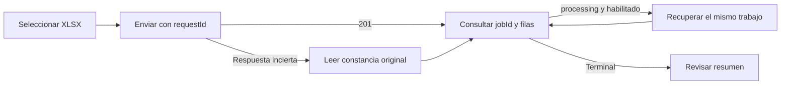

# Catálogo

**Corte final.** SEARCH y CREATE acreditados en el recorrido ensayado. El primer guardado de presentaciones queda acreditado por HTTP y PostgreSQL. P5 se interrumpe al comprobar la versión obsoleta. [RUN-30](../VALIDATION.md#run-30).

**Corte histórico RUN-18–21.** [RUN-18](../VALIDATION.md#run-18) agrega el candidato L-06B y delimita las pruebas por UC. [RUN-21](../VALIDATION.md#run-21) acredita SEARCH y sitúa el FAIL del piloto en CREATE/POST_LOST_ACK. No atribuye causa al alta ni a F-007. Se conserva la evidencia local y quedan pendientes la sesión perdida, CAT-19 con writer drain y E5. [RUN-17](../VALIDATION.md#run-17) acredita la búsqueda POS por código dentro de P4. [Decisiones de diseño](../TO_BE.md).

[Validación RFA2](../VALIDATION.md) · SC-04. E2 identifica la frontera con dobles o pruebas locales. BLOCKED indica una frontera esencial sin evidencia aislada.

Productos es Owner (`frontend/src/features/catalog/ProductsPage.tsx:32–49`); POS usa contratos de sucursal y la búsqueda devuelve coincidencias y alternativas, no sustitución clínica. `CatalogEndpoints.cs:18–81` separa mantenimiento paginado, consultas operativas y corrección auditada. Lecturas y mutaciones privadas atraviesan `TenantEndpoints.cs:15–19`. Los contratos de administración y operación comparten autenticación y aplican permisos diferentes.

## UC-CAT-01

GET `/api/tenants/{tenantId}/branches/{branchId}/operational-products` · `backend/src/MediPOS.Api/Tenant/CatalogEndpoints.cs:18`. **E3 · IMPLEMENTADO · BLOCKED**. En POS abrir catálogo. Catálogo operativo de sucursal recibe filtros de consulta. OperationalCatalogQueries.cs:12–17 valida ProductSearch en la sede antes y después de leer; OperationalCatalogReader.cs:9–19 filtra productos activos por tenant, término/categoría y pagina. La respuesta sirve la grilla operativa sin escritura. Requisito FR-CAT-001. [RUN-21](../VALIDATION.md#run-21): GET real de Cajero excluye inactivo; grilla y stock no ejercitados.

## UC-CAT-02

GET `/api/tenants/{tenantId}/branches/{branchId}/operational-categories` · `backend/src/MediPOS.Api/Tenant/CatalogEndpoints.cs:21`. **E2 · IMPLEMENTADO · BLOCKED**. En POS elegir categoría. Consulta de directorio operacional paginada. OperationalCatalogQueries.cs:20–25 verifica ProductSearch y pagina categorías. CatalogDirectoryReader.cs:11–13 lee categorías activas; datos de referencia compartidos. La UI usa el resultado como selector. Requisito FR-CAT-001.

## UC-CAT-03

PUT `/api/tenants/{tenantId}/products/{productId}/local-data` · `backend/src/MediPOS.Api/Tenant/CatalogEndpoints.cs:24`. **E3 · IMPLEMENTADO · BLOCKED**. Editar datos locales desde ficha y guardar con revisión observada. ProductDetailPanel/EditLocalProduct → UpdateLocalProductHandler.cs:16–32 verifica revisión bloqueada y registra before/after. BusinessProductStore.cs:62,79 bloquea business_products con xmin y persiste auditoría. Global y snapshots quedan fuera del payload; recuperación UC-CAT-21. [RUN-30](../VALIDATION.md#run-30) · EDIT supera corrección de datos y 409 de revisión obsoleta de datos locales.

## UC-CAT-04

GET `/api/tenants/{tenantId}/categories` · `backend/src/MediPOS.Api/Tenant/CatalogEndpoints.cs:29`. **E4 · IMPLEMENTADO · BLOCKED**. Cargar categorías en selector de alta/filtro. ProductsPage.tsx:58–65 pagina la consulta. CatalogDirectoryQueries.cs:23–24,47–54 exige Administración antes/después. CatalogDirectoryReader.cs:11–13 proyecta activas paginadas; el selector no modifica datos. Requisito FR-CAT-001. [RUN-21](../VALIDATION.md#run-21): categoría administrativa usada en selector real; otras variantes sin promoción.

## UC-CAT-05

GET `/api/tenants/{tenantId}/global-products` · `backend/src/MediPOS.Api/Tenant/CatalogEndpoints.cs:31`. **E2 · IMPLEMENTADO · BLOCKED**. Abrir Catálogo global y consultar página. API offset/limit; asociación se escribe por separado. CatalogDirectoryQueries.cs:25–26,47–54 exige Administración. CatalogDirectoryReader.cs:14–16 proyecta referencia global paginada, sin precios ni stock tenant. La asociación es UC-CAT-10. Requisito FR-CAT-001.

## UC-CAT-06

GET `/api/tenants/{tenantId}/products` · [CatalogEndpoints](../../../../backend/src/MediPOS.Api/Tenant/CatalogEndpoints.cs). **E4 · IMPLEMENTADO · BLOCKED**. Abrir Mis productos, aplicar texto, categoría o estado y consultar páginas del resultado. CatalogDirectoryQueries revalida Administración después de leer. CatalogDirectoryReader aplica tenant, filtros y orden por ID antes de paginar. Sin filtros se conserva el arreglo y orden anterior, con evidencia E3 histórica. El filtro nuevo tiene evidencia local E2 y traducción Npgsql offline. RUN-21 acredita el filtro en navegador y sus negativos por API. La revocación dinámica conserva evidencia previa con dobles. FR-CAT-001/010, F-003. [RUN-21](../VALIDATION.md#run-21): 51 filas, paginación, filtro y escape literal, 400/403 y consulta de segundo tenant.

## UC-CAT-07

GET `/api/tenants/{tenantId}/branches/{branchId}/products/{productId}` · `backend/src/MediPOS.Api/Tenant/CatalogEndpoints.cs:40`. **E3 · IMPLEMENTADO · BLOCKED**. Abrir ficha de producto y sus presentaciones. ProductLookup y ProductsPage comparten clave scoped catalog-detail. CatalogDirectoryQueries.cs:38–46 valida ProductSearch por sede y vuelve a autorizar. CatalogDirectoryReader.cs:47 y siguientes proyecta producto y unidades por tenant y producto. UI vuelve al acuse/detalle scoped. Requisito FR-CAT-006.

## UC-CAT-08

GET `/api/tenants/{tenantId}/branches/{branchId}/products/search` · [CatalogEndpoints](../../../../backend/src/MediPOS.Api/Tenant/CatalogEndpoints.cs). **E4 · IMPLEMENTADO · BLOCKED**. En POS o Inventario, escribe nombre, código o ingrediente y elige un resultado. InlineProductLookup y SearchProductsHandler autorizan ProductSearch antes y después de leer. ProductSearchStore busca activos y stock vendible por sede. RUN-17 P4 acredita búsqueda por código y elección de presentación. Ingredientes, alternativas y las demás variantes conservan su evidencia anterior. FR-POS-002/003.

## UC-CAT-09

POST `/api/tenants/{tenantId}/products/local` · `backend/src/MediPOS.Api/Tenant/CatalogEndpoints.cs:48`. **E4 · IMPLEMENTADO · BLOCKED**. Como Owner, abre Nuevo producto, completa datos locales y guarda. CatalogEndpoints.cs:48–53 recibe LocalProductRequest. CreateLocalBusinessProductHandler.cs:15–48 verifica administración/licencia y categoría, construye datos de negocio y agrega producto y auditoría por BusinessProductStore; 201 devuelve identificador. Si se pierde respuesta, useCatalogWrite.ts conserva intención/código para contrastar con ficha, sin repetir alta. [RUN-21](../VALIDATION.md#run-21): CREATE FAIL POST_LOST_ACK; envío y commit sin confirmar. [RUN-22](../VALIDATION.md#run-22) · contraste del POST con producto, auditoría y stock preparado; NOT_RUN. RUN-23 constató el 201 prematuro durante Revisión, con producto y auditoría persistidos y cero stock. La corrección local de RUN-24 separa Continuar de Guardar. En el corte RUN-24, E4 correspondía al fallo del baseline y el correctivo esperaba su prueba real. RUN-25: F-008 corregido en alta local real; un 201 deliberado, auditoría Owner y cero stock. RUN-27: alta local deliberada E4, una fila y auditoría Owner, cero stock. [RUN-30](../VALIDATION.md#run-30) · CREATE E4: un POST deliberado, 201/aborto, una fila y auditoría Owner, cero stock.

## UC-CAT-10

POST `/api/tenants/{tenantId}/products/from-global` · `backend/src/MediPOS.Api/Tenant/CatalogEndpoints.cs:54`. **E3 · IMPLEMENTADO · BLOCKED**. En Catálogo global, selecciona referencia, ingresa código y precios, y confirma. CatalogEndpoints.cs:54–58 recibe GlobalProductRequest. CreateBusinessProductFromGlobalHandler.cs:14–43 valida alcance y licencia, carga referencia global y persiste vínculo local y auditoría mediante BusinessProductStore. 201 devuelve producto del tenant, sin disponibilidad de inventario implícita. Conciliación UC-CAT-21. RUN-24 verifica en DOM que Continuar no escribe y que Asociar con Enter emite un POST. La regresión B-02 de F-008 está preparada y pendiente de ejecución. RUN-27: asociación NOT_RUN; RUN-28: regresión de asociación con doble HTTP. [RUN-30](../VALIDATION.md#run-30) · Etapa posterior a UNITS_STALE no alcanzada en P5; se conserva la evidencia anterior.

## UC-CAT-11

PUT `/api/tenants/{tenantId}/products/{productId}/prices` · `backend/src/MediPOS.Api/Tenant/CatalogEndpoints.cs:59`. **E3 · IMPLEMENTADO · BLOCKED**. Desde la ficha, guarda precios minorista y mayorista opcional. CatalogEndpoints.cs:59–63 y UpdateBusinessProductPricesHandler.cs:12–41 validan administración/licencia y actualizan el BusinessProduct local con auditoría en BusinessProductStore.cs:79. El DTO devuelve el producto actualizado. Si falta respuesta verifica la ficha original (UC-CAT-21). [RUN-30](../VALIDATION.md#run-30) · EDIT supera PUT de precios; relectura de precios al final de P5 NOT_RUN.

## UC-CAT-12

PUT `/api/tenants/{tenantId}/products/{productId}/status` · `backend/src/MediPOS.Api/Tenant/CatalogEndpoints.cs:64`. **E3 · IMPLEMENTADO · BLOCKED**. Desde la ficha, cambia disponibilidad del producto. SetBusinessProductStatusHandler.cs:12–38 valida administración/licencia y aplica IsActive en BusinessProductStore.cs:79 con auditoría si cambia. El resultado mantiene el ID y los datos históricos. POS filtra inactivos; consulta la ficha tras una respuesta ambigua. [RUN-30](../VALIDATION.md#run-30) · Etapa posterior a UNITS_STALE no alcanzada en P5; se conserva la evidencia anterior.

## UC-CAT-13

GET `/api/tenants/{tenantId}/products/{productId}/unit-configuration` · `backend/src/MediPOS.Api/Tenant/CatalogEndpoints.cs:69`. **E3 · IMPLEMENTADO · BLOCKED**. Abre Presentaciones. ProductDetailPanel.tsx:64–86 consulta configuración del producto seleccionado. ProductUnitConfigurationHandler.cs:17–33 exige administración y ProductUnitConfigurationStore.cs:13–21 proyecta unidades y versión xmin por tenant/producto. La versión se conserva para guardar UC-CAT-14; ante lectura fallida se consulta el mismo producto. RUN-27: F-009 EDIT/UNITS FAIL, frontera de GET y PUT sin aserción individual; RFA5A. [RUN-29](../VALIDATION.md#run-29) prepara categoría HTTP y contraste de la versión GET con un snapshot runtime independiente. [RUN-30](../VALIDATION.md#run-30) · GET 200 y versión cotejada con PostgreSQL por HTTP directo (E3); editor interactivo pendiente.

## UC-CAT-14

PUT `/api/tenants/{tenantId}/products/{productId}/unit-configuration` · `backend/src/MediPOS.Api/Tenant/CatalogEndpoints.cs:72`. **E3 · IMPLEMENTADO · BLOCKED**. Edita presentaciones y guarda la versión obtenida al abrir. ProductUnitConfigurationHandler.cs:38–63 autoriza administración, contrasta estado y referencias de unidades; ProductUnitConfigurationStore.cs:23–61 bloquea el producto por tenant, condiciona UPDATE al xmin esperado, persiste unidades y auditoría y devuelve nueva versión. Ante conflicto o pérdida de respuesta, recarga configuración antes de repetir. RUN-27: F-009 EDIT/UNITS FAIL, PUT versionado y negativa 409 sin acreditar en ese run; RFA5A. [RUN-29](../VALIDATION.md#run-29) prepara la relectura de versión, unidades exactas, auditoría y efectos antes del PUT, después del PUT y después del conflicto. [RUN-30](../VALIDATION.md#run-30) · Primer PUT 200, versión nueva, base 1 y caja 10.125 activas, una auditoría Owner; recuentos comerciales iguales. UNITS_STALE sin estado HTTP, sin cotejo tras conflicto. E3.

## UC-CAT-15

PUT `/api/tenants/{tenantId}/products/{productId}/units` · `backend/src/MediPOS.Api/Tenant/CatalogEndpoints.cs:77`. **E2 · NO_EXPUESTO · BLOCKED**. Cliente compat.: envía lista de unidades para un producto existente. CatalogEndpoints.cs:77–81 y ReplaceProductUnitsHandler.cs:42 y siguientes validan administración/licencia y comparan los snapshots. Una petición equivalente devuelve las unidades anteriores. Un cambio efectivo recibe 409 catalog.units_legacy_write_blocked (RUN-10). La ruta no recibe ExpectedVersion; el editor actual usa UC-CAT-14. El cliente puede verificar unidades en la ficha original. [RUN-30](../VALIDATION.md#run-30) · Etapa posterior a UNITS_STALE no alcanzada en P5; se conserva la evidencia anterior.

## UC-CAT-16

GET `/api/tenants/{tenantId}/product-imports/template` · `backend/src/MediPOS.Api/Tenant/ImportEndpoints.cs:11`. **E2 · IMPLEMENTADO · BLOCKED**. En Importación pulsa Descargar plantilla. ImportPage.tsx:101–106 descarga blob; ImportEndpoints.cs:11–15 llama GenerateTenantProductImportTemplateHandler, que comprueba administración y genera XLSX. No modifica productos ni crea trabajo; la descarga puede volver a solicitarse.

## UC-CAT-17

POST `/api/tenants/{tenantId}/product-imports` · `backend/src/MediPOS.Api/Tenant/ImportEndpoints.cs:16`. **E3 · IMPLEMENTADO · BLOCKED**. Selecciona XLSX y pulsa Importar. ImportPage.tsx:58–69 conserva requestId; ImportEndpoints.cs:16–28 limita tamaño y tipo y registra RecoverableWriteFilter. ImportProductsFromExcelHandler valida administración y filas; ProductImportStore.cs:124–221 mantiene lease y persiste resultados/producto/auditoría por fila, reautoriza antes de commit y cierra trabajo en otra transacción. 201 devuelve el trabajo y resumen; si se pierde, consulta constancia y mismo trabajo (UC-CAT-18), sin reenviar archivo.

## UC-CAT-18

GET `/api/tenants/{tenantId}/product-imports/{importJobId}` · `backend/src/MediPOS.Api/Tenant/ImportEndpoints.cs:29`. **E3 · IMPLEMENTADO · BLOCKED**. Abre resultado del trabajo y pagina errores. ImportPage.tsx:40–52,72–89 y ImportEndpoints.cs:29–34 usan jobId y cursor de fila. GetImportJobResultHandler y ProductImportStore.cs:286–294 autorizan y leen trabajo/resultados ordenados en alcance tenant. CanRecoverInterrupted exige processing y flag posterior a writer drain. La consulta no reimporta.

## UC-CAT-19

POST `/api/tenants/{tenantId}/product-imports/{importJobId}/recover-interrupted` · `backend/src/MediPOS.Api/Tenant/ImportEndpoints.cs:35`. **E3 · IMPLEMENTADO · BLOCKED**. En un trabajo interrumpido elegible, pulsa recuperar; usa el mismo jobId. ImportPage.tsx:79–89 y RecoverInterruptedImportHandler.cs:11–24 aplican flag y administración. ProductImportStore.cs:243–284 toma lease y bloqueo del trabajo, reautoriza, conserva filas comprometidas y persiste cierre auditado; un trabajo terminal ya no se modifica. Consulta el mismo trabajo después del intento, sin volver a subir el archivo.

## UC-CAT-20

Cambiar vista y aplicar filtros sobre Mis productos. **E4 · IMPLEMENTADO · BLOCKED**. Elegir lista o tarjetas, preparar los filtros y pulsar Aplicar o Enter. Una sola consulta inicia desde offset cero y las siguientes mantienen esos filtros. Limpiar restaura el directorio. El PASS de la antigua vista por página sigue en RUN-04. El filtro ampliado se acreditó en SEARCH. La vista de tarjetas queda fuera de ese escenario. FR-CAT-010, F-003. [RUN-21](../VALIDATION.md#run-21): filtro y limpieza en navegador real; variante tarjetas no recorrida.

## UC-CAT-21

Recuperar escritura de producto. **E4 · IMPLEMENTADO · BLOCKED**. Tras alta incierta la persona vuelve a Mis productos, busca y verifica la ficha del código almacenado por identidad, tenant, sede y membresía. Tras una edición incierta verifica el ID original. Otra ficha conserva el bloqueo aunque se marque el checkbox. Las altas previas sin identificador verificable requieren soporte. El flujo no reenvía escrituras. F-007, [RUN-18](../VALIDATION.md#run-18). [RUN-21](../VALIDATION.md#run-21): REENTRY y RECONCILIATION no alcanzadas; F-007 conserva RED/GREEN local. [RUN-22](../VALIDATION.md#run-22) · guarda estable, reentrada y conciliación del mismo ID preparadas; NOT_RUN. RUN-23 falló antes de la reentrada. RUN-24 conserva el bloqueo ante otra ficha y concilia la original sin repetir el POST con dobles HTTP. RUN-25: guarda y reentrada E4; conciliación final FAIL. RUN-26: caracterización focalizada con doble HTTP y aserciones P5 pendientes. RUN-27: CREATE PASS, original conciliado sin reenvío E4; variante ficha ajena E2. RUN-28: panel único y continuidad DOM. [RUN-30](../VALIDATION.md#run-30) · CREATE E4: reentrada y conciliación del original sin reenvío; negativa de ficha ajena E2, pérdida completa del almacenamiento pendiente.

## UC-CAT-22

Borrado físico de producto. **E1 · NO_EXPUESTO · N/A**. La superficie encontrada ofrece status inactivo y no hay ruta DELETE de productos en CatalogEndpoints. La clasificación se limita al recorrido de usuario y al contrato HTTP operativo.

## Estados de importación

## Fuentes

- [ProductsPage.tsx](../../../../frontend/src/features/catalog/ProductsPage.tsx)
- [CatalogEndpoints.cs](../../../../backend/src/MediPOS.Api/Tenant/CatalogEndpoints.cs)
- [TenantEndpoints.cs](../../../../backend/src/MediPOS.Api/Tenant/TenantEndpoints.cs)
- [OperationalCatalogQueries.cs](../../../../backend/src/MediPOS.Application/Modules/Catalog/OperationalCatalogQueries.cs)
- [OperationalCatalogReader.cs](../../../../backend/src/MediPOS.Infrastructure/Modules/Catalog/Persistence/OperationalCatalogReader.cs)
- [CatalogDirectoryReader.cs](../../../../backend/src/MediPOS.Infrastructure/Modules/Catalog/Persistence/CatalogDirectoryReader.cs)
- [UpdateLocalProductHandler.cs](../../../../backend/src/MediPOS.Application/Modules/Catalog/UpdateLocalProductHandler.cs)
- [BusinessProductStore.cs](../../../../backend/src/MediPOS.Infrastructure/Modules/Catalog/Persistence/BusinessProductStore.cs)
- [CatalogDirectoryQueries.cs](../../../../backend/src/MediPOS.Application/Modules/Catalog/CatalogDirectoryQueries.cs)
- [ProductDetailPanel.tsx](../../../../frontend/src/features/catalog/ProductDetailPanel.tsx)
- [ProductUnitConfigurationHandler.cs](../../../../backend/src/MediPOS.Application/Modules/Catalog/ReplaceProductUnits/ProductUnitConfigurationHandler.cs)
- [ImportEndpoints.cs](../../../../backend/src/MediPOS.Api/Tenant/ImportEndpoints.cs)
- [RecoverInterruptedImportHandler.cs](../../../../backend/src/MediPOS.Application/Modules/Catalog/ProductImport/RecoverInterruptedImportHandler.cs)
- [useCatalogWrite.ts](../../../../frontend/src/features/catalog/useCatalogWrite.ts)
- [Prueba relacionada de la familia](../../../../backend/tests/MediPOS.UnitTests/Modules/Catalog/ProductUnitConfigurationTests.cs) · E0 de ejecución, se inventaría por contexto; no atribuir cobertura de todas las variantes.

