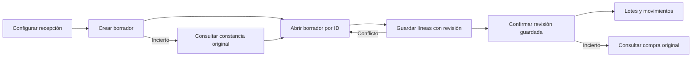

# Compras e inventario

**Corte vigente.** Las etiquetas por UC incorporan [RUN-10](../VALIDATION.md#run-10). La columna de aserciones delimita el escenario ejecutado. Las recetas AS-IS describen el diagnóstico anterior. [Decisiones de diseño](../TO_BE.md).

[Validación RFA2](../VALIDATION.md) · SC-05 / SC-06. E2 identifica la frontera con dobles o pruebas locales. BLOCKED indica una frontera esencial sin evidencia aislada.

RUN-09 amplía F-005 para UC-COM-03/04. Con tres IDs, se observan tres GET de detalle en frío, cero al abrir Lotes con caché vigente y tres tras cambiar de sede. [Prueba con doble HTTP](../VALIDATION.md#corte-anterior--continuación-02b--5d38898).

Compras e Inventario requieren Owner o Pharmacist en las páginas (`PurchasesPage.tsx:25–29`, `InventoryPage.tsx:29–33`). Mínimo es Owner. Líneas con revisión, lote/vencimiento y costo exacto. La autorización se reevalúa en servidor; escritura con constancia pasa por las operaciones comunes de UC-ACC-24. Ver el [recorrido propuesto](../TO_BE.md).

## UC-COM-01

GET `/api/tenants/{tenantId}/branches/{branchId}/inventory/expiring-lots` · `backend/src/MediPOS.Api/Tenant/InventoryEndpoints.cs:13`. **E3 · IMPLEMENTADO · BLOCKED**. Abrir Por vencer, buscar o paginar. InventoryDirectoryQueries.cs:22–28 obtiene lotes de la sede, calcula ventana con fecha Lima y proyecta según rol. InventoryDirectoryReader.cs:23–34 une lotes y líneas originales y ordena por vencimiento. UI muestra costo solo para Owner. Filtros por productId, offset y límite. Requisito FR-INV-003;FR-INV-007.

## UC-COM-02

PUT `/api/tenants/{tenantId}/branches/{branchId}/products/{productId}/stock-threshold` · `backend/src/MediPOS.Api/Tenant/InventoryEndpoints.cs:16`. **E3 · IMPLEMENTADO · PASS**. Elegir producto y configurar mínimo. useInventoryWrite.ts:20–51 mantiene intención y recibe mínimo aplicado; InventoryEndpoints.cs:16–20 usa constancia, SetBranchProductStockThresholdHandler.cs:37–58 valida scope y guarda umbral más auditoría. InventoryPage.tsx:62,125 muestra el acuse; InventoryEndpoints.cs:13–31 no ofrece un GET individual de mínimo. El dato también alimenta reportes de riesgo y reposición, que son lecturas agregadas.

## UC-COM-03

GET `/api/tenants/{tenantId}/branches/{branchId}/inventory/stock` · `backend/src/MediPOS.Api/Tenant/InventoryEndpoints.cs:21`. **E3 · IMPLEMENTADO · BLOCKED**. Abrir Existencias, elegir producto filtrado. InventoryPage.tsx:39–48 consulta sucursal con productId y offset. DTO de stock utiliza cantidad base e ID; visualización del nombre consulta detalle. SQL de InventoryDirectoryQueries.cs:17–18,31 y siguientes comprueba TenantOperation.Inventory; InventoryDirectoryReader.cs:9–15 agrupa lotes por producto, suma disponible y pagina bajo ámbito del tenant y sede. Nombre mediante detalle cacheado. Requisito FR-TEN-003. Indicio F-005.

## UC-COM-04

GET `/api/tenants/{tenantId}/branches/{branchId}/inventory/lots` · `backend/src/MediPOS.Api/Tenant/InventoryEndpoints.cs:24`. **E3 · IMPLEMENTADO · BLOCKED**. Abrir Lotes, seleccionar filtro y leer saldo, vencimiento y acción Ajustar. InventoryPage.tsx:39–48,103–109. InventoryDirectoryQueries.cs:19–20,31 y siguientes comprueba InventoryRead; InventoryDirectoryReader.cs:17–22 filtra lotes y pagina por vencimiento/ID en sede. Ajuste es acción separada. Requisito FR-INV-001. Indicio F-005.

## UC-COM-05

POST `/api/tenants/{tenantId}/inventory/lots/{lotId}/adjustments` · `backend/src/MediPOS.Api/Tenant/InventoryEndpoints.cs:27`. **E3 · IMPLEMENTADO · PASS**. Abrir lote y registrar ajuste con motivo. InventoryEndpoints.cs:27–31 y useInventoryWrite.ts:20–51 vinculan constancia. AdjustStockHandler.cs:19–49 valida actor/scope y genera movimiento auditado, sin mutar saldo arbitrariamente. Reconsulta saldo/constancia; StockAdjustmentTransaction.cs:30,65–69 bloquea lote y agrega movimiento/auditoría. RecoverableOperations.cs:39–101 controla constancia/commit cuando el scope es externo. Releer saldo o constancia; solo la segunda acredita la intención. Requisito FR-INV-005;FR-INV-006.

## UC-COM-06

POST `/api/tenants/{tenantId}/suppliers` · `backend/src/MediPOS.Api/Tenant/PurchasingEndpoints.cs:15`. **E3 · IMPLEMENTADO · BLOCKED**. En Compras selecciona Nuevo proveedor, completa datos y guarda. SuppliersPanel conserva la intención por separado. PurchasingEndpoints.cs:15–19 recibe SupplierRequest; CreateSupplierHandler.cs:16–27 aplica permiso de compras/licencia y PurchasingStore guarda proveedor/auditoría. RecoverableOperations.cs:39–101 serializa y confirma negocio y constancia en un commit. El 201 habilita seleccionarlo; ante pérdida consulta la constancia supplier original.

## UC-COM-07

GET `/api/tenants/{tenantId}/branches/{branchId}/suppliers` · `backend/src/MediPOS.Api/Tenant/PurchasingEndpoints.cs:20`. **E3 · IMPLEMENTADO · BLOCKED**. Abrir Elegir proveedor y paginar. PurchaseDirectoryQueries.cs:18–25 autoriza Purchasing por sede antes/después. PurchaseDirectoryReader.cs:11–16 usa tenant, devuelve activos paginados. Selección reutiliza proveedor; no crea registro. Requisito FR-PUR-001.

## UC-COM-08

POST `/api/tenants/{tenantId}/branches/{branchId}/purchases` · `backend/src/MediPOS.Api/Tenant/PurchasingEndpoints.cs:23`. **E3 · IMPLEMENTADO · BLOCKED**. Elige proveedor y referencia opcionales y pulsa Continuar. usePurchaseReceipt.ts:105–146 conserva intención. PurchasingEndpoints.cs:23–27 y CreatePurchaseHandler.cs:15–29 autorizan sede/licencia y crean borrador sin movimientos; PurchasingStore.cs:20–26 y RecoverableOperations.cs:89–101 guardan compra/auditoría/constancia en transacción. 201 contiene ID para seguir editando.

## UC-COM-09

GET `/api/tenants/{tenantId}/branches/{branchId}/purchases/{purchaseId}` · `backend/src/MediPOS.Api/Tenant/PurchasingEndpoints.cs:28`. **E3 · IMPLEMENTADO · BLOCKED**. Abrir recepción por referencia o URL purchase. PurchaseDirectoryQueries.cs:27–34 valida acceso en la sucursal y devuelve revisión; PurchaseDirectoryReader.cs:17–23 limita a tenant/sede/ID y lee líneas en orden. La misma URL recupera el borrador/acuse; error o otra sede no equivalen a eliminado. Requisito FR-PUR-002. Indicio F-004.

## UC-COM-10

PUT `/api/tenants/{tenantId}/purchases/{purchaseId}/lines` · `backend/src/MediPOS.Api/Tenant/PurchasingEndpoints.cs:32`. **E3 · IMPLEMENTADO · BLOCKED**. Añade/edita productos, cantidades, lote y vencimiento; guarda líneas. PurchasingEndpoints.cs:32–36 recibe ExpectedRevision. ReplacePurchaseLinesHandler.cs:25–55 autoriza en la sede, bloquea compra, compara revisión de líneas observada y valida producto/unidad; PurchasingStore.cs:43–44,66–76 reemplaza líneas del borrador. Revisión nueva a partir del resultado; ante conflicto o respuesta perdida, relee la compra y conserva edición local para contrastar.

## UC-COM-11

**RUN-13.** PostgreSQL acredita que una revisión obsoleta rechaza la confirmación sin escribir lotes ni movimientos. El caso DOM correspondiente falló en CI y pasó en las dos selecciones locales. La sincronización exacta que falló en CI sigue sin identificar. [Evidencia](../VALIDATION.md#run-13).

POST `/api/tenants/{tenantId}/purchases/{purchaseId}/confirm` · `backend/src/MediPOS.Api/Tenant/PurchasingEndpoints.cs:37`. **E3 · IMPLEMENTADO · BLOCKED**. Confirmar recepción desde el resumen revisado. ConfirmPurchaseHandler.cs:21–56 valida revisión dentro del ámbito transaccional, valida líneas/catálogo, confirma y guarda auditoría y stock; PurchasingStore.cs:43–44,76 y usePurchaseReceipt.ts:67–103 enlazan candado y acuse. Si acuse incierto se consulta la misma recepción; draft temprano no prueba rollback.

[RUN-31](../VALIDATION.md#run-31) · Revisión obsoleta provocada con doble HTTP: 409, un solo POST, bloqueo durante la relectura y borrador actualizado al finalizar. PostgreSQL pendiente para el candidato.

## UC-COM-12

GET `/api/tenants/{tenantId}/branches/{branchId}/purchases/search` · `backend/src/MediPOS.Api/Tenant/PurchasingEndpoints.cs:42`. **E3 · IMPLEMENTADO · BLOCKED**. Buscar por referencia y abrir fila; no es clave única ni historial. FindPurchasesByDocumentReferenceHandler.cs:11–27 valida permiso Purchasing, trim/paginación y ámbito de resultado antes/después de leer. PurchasingStore.cs:84–90 compara igualdad documental y filtra sede. No hay consulta de historial general en el mapa. Un resultado por referencia no prueba identidad de una operación incierta. Requisito FR-PUR-004. Indicio F-004. [RUN-20](../VALIDATION.md#run-20): filas fuera del ámbito que retorna el puerto provocan fallo cerrado (xUnit con dobles).

## UC-COM-13

Editar recepción local y volver. **E2 · IMPLEMENTADO · BLOCKED**. Volver a compras y retomar mantiene el editor sin nueva escritura. PurchasesPage.tsx conserva directorio/formularios montados y evita mostrar otro ID. Regresión PurchasesPage.test.tsx sobre retomar campos.

## UC-COM-14

Recuperar recepción o proveedor. **E3 · IMPLEMENTADO · BLOCKED**. Ante alta incierta en Compras o Proveedores, elige consultar operación; conserva el mismo requestId. usePurchaseReceipt.ts:105–146 y SuppliersPanel separan claves. RecoverableOperations.cs:29–101 lee constancia por actor/membresía/tenant/sede/tipo y protege comparación de payload. Si se observa constancia 201, se usa su identificador; 404 solo indica que aún no es visible. No reiniciar alta para conciliar.

## UC-COM-15

Asignación FEFO. **E3 · IMPLEMENTADO · PASS**. FEFO se ejecuta al descontar en POS. Ver SaleCheckoutTransaction y SaleConfirmationPosting; SaleCheckoutTransaction.cs:128–146 selecciona lote de la sede y producto con existencias positivas, descarta vencidos en rama FEFO y usa vencimiento/fecha/ID con bloqueo. SaleConfirmationPosting.cs:94–134 usa los movimientos al confirmar; la reserva y serie exacta están dentro de la transacción. Requisito FR-INV-002.

## Compra, revisión y existencias

## Fuentes

- [PurchasesPage.tsx](../../../../frontend/src/features/purchasing/PurchasesPage.tsx)
- [InventoryPage.tsx](../../../../frontend/src/features/inventory/InventoryPage.tsx)
- [InventoryEndpoints.cs](../../../../backend/src/MediPOS.Api/Tenant/InventoryEndpoints.cs)
- [InventoryDirectoryQueries.cs](../../../../backend/src/MediPOS.Application/Modules/Inventory/InventoryDirectoryQueries.cs)
- [InventoryReadStore.cs](../../../../backend/src/MediPOS.Infrastructure/Modules/Inventory/Persistence/InventoryReadStore.cs)
- [useInventoryWrite.ts](../../../../frontend/src/features/inventory/useInventoryWrite.ts)
- [SetBranchProductStockThresholdHandler.cs](../../../../backend/src/MediPOS.Application/Modules/Inventory/SetBranchProductStockThreshold/SetBranchProductStockThresholdHandler.cs)
- [InventoryDirectoryReader.cs](../../../../backend/src/MediPOS.Infrastructure/Modules/Inventory/Persistence/InventoryDirectoryReader.cs)
- [AdjustStockHandler.cs](../../../../backend/src/MediPOS.Application/Modules/Inventory/AdjustStock/AdjustStockHandler.cs)
- [StockAdjustmentTransaction.cs](../../../../backend/src/MediPOS.Infrastructure/Modules/Inventory/Persistence/StockAdjustmentTransaction.cs)
- [RecoverableOperations.cs](../../../../backend/src/MediPOS.Infrastructure/Persistence/RecoverableOperations.cs)
- [PurchasingEndpoints.cs](../../../../backend/src/MediPOS.Api/Tenant/PurchasingEndpoints.cs)
- [usePurchaseReceipt.ts](../../../../frontend/src/features/purchasing/usePurchaseReceipt.ts)
- [PurchasingStore.cs](../../../../backend/src/MediPOS.Infrastructure/Modules/Purchasing/Persistence/PurchasingStore.cs)
- [ConfirmPurchaseHandler.cs](../../../../backend/src/MediPOS.Application/Modules/Purchasing/ConfirmPurchase/ConfirmPurchaseHandler.cs)
- [PurchaseLookup.tsx](../../../../frontend/src/features/purchasing/PurchaseLookup.tsx)
- [SaleCheckoutTransaction.cs](../../../../backend/src/MediPOS.Infrastructure/Modules/SalesPos/Persistence/SaleCheckoutTransaction.cs)
- [SaleConfirmationPosting.cs](../../../../backend/src/MediPOS.Application/Modules/SalesPos/ConfirmSale/SaleConfirmationPosting.cs)
- [Prueba relacionada de la familia](../../../../frontend/src/features/purchasing/PurchasesPage.test.tsx) · E0 de ejecución, se inventaría por contexto; no atribuir cobertura de todas las variantes.

- [PurchaseDirectoryQueries.cs](../../../../backend/src/MediPOS.Application/Modules/Purchasing/PurchaseDirectoryQueries.cs)
- [PurchaseDirectoryReader.cs](../../../../backend/src/MediPOS.Infrastructure/Modules/Purchasing/Persistence/PurchaseDirectoryReader.cs)
- [FindPurchasesByDocumentReferenceHandler.cs](../../../../backend/src/MediPOS.Application/Modules/Purchasing/FindPurchasesByDocumentReference/FindPurchasesByDocumentReferenceHandler.cs)

