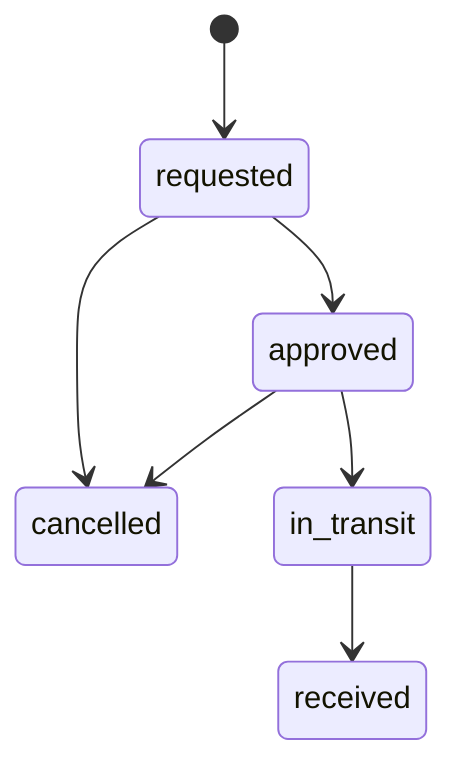

# Transferencias

Mercadería conserva aprobación, despacho y recepción separados. El cajero no adquiere autoridad de origen por tener la sede destino. Sencillo requiere Owner/Cashier y caja autorizada de la sede. Ambas familias guardan ID/intención mediante `useTrackedTransfer.ts:58–113`. TO-BE PENDIENTE_RFA3.

## UC-TRA-01

POST `/api/tenants/{tenantId}/branches/{branchId}/cash-transfers` · `backend/src/MediPOS.Api/Tenant/CashTransferEndpoints.cs:19`. **E1 · IMPLEMENTADO · NOT_RUN**. Elegir caja/sede/importe y confirmar. CashTransfersPage.tsx:56–65,98–101 requiere saldo esperado no nulo. CashSessionStatusQueries.cs:18–28 retorna valor persistido, nulo para open (CashSession.cs:54–60). La UI bloquea el flujo normal. En API el candado y cálculo vigente los realiza CashTransferTransaction.cs:57–73,90–96; la constancia se asocia a la intención original. Requisito FR-CASH-004. Indicio F-002.

## UC-TRA-02

GET `/api/tenants/{tenantId}/cash-transfers/pending` · `backend/src/MediPOS.Api/Tenant/CashTransferEndpoints.cs:21`. **E0 · IMPLEMENTADO · NOT_RUN**. Consultar envíos pendientes y destino. CashTransferReader.cs:15–24 solo InTransit, por tenant y destino opcional. La UI conserva filtros. Autorización exacta de destinos por revisar.

## UC-TRA-03

GET `/api/tenants/{tenantId}/cash-transfers/{cashTransferId}` · `backend/src/MediPOS.Api/Tenant/CashTransferEndpoints.cs:24`. **E0 · IMPLEMENTADO · NOT_RUN**. Elegir Ver y abrir ficha, o recuperar ID original. CashTransferReader.cs:10–14 consulta identidad/tenant. Alcance actor origen-destino del handler pendiente.

## UC-TRA-04

POST `/api/tenants/{tenantId}/cash-transfers/{cashTransferId}/receive` · `backend/src/MediPOS.Api/Tenant/CashTransferEndpoints.cs:27`. **E0 · IMPLEMENTADO · NOT_RUN**. Desde destino, seleccionar caja abierta y confirmar recepción completa. CashTransferTransaction.cs:37–52,107–125 guarda el acuse y auditoría en la misma transición. Confirmar condiciones actor/sede del handler antes de elevar evidencia.

## UC-TRA-05

GET `/api/tenants/{tenantId}/transfers` · `backend/src/MediPOS.Api/Tenant/TransferEndpoints.cs:21`. **E1 · IMPLEMENTADO · NOT_RUN**. Abrir Mercadería y filtrar sede/estado. GetTransfersHandler.cs:16–32 valida página, estado y sede, reservando consulta sin sede para Owner. TransferDirectoryReader.cs:9 y siguientes filtra tenant y ambos lados del traslado y proyecta paginado. Cambiar filtro causa una nueva lectura.

## UC-TRA-06

POST `/api/tenants/{tenantId}/transfers` · `backend/src/MediPOS.Api/Tenant/TransferEndpoints.cs:24`. **E1 · IMPLEMENTADO · NOT_RUN**. Crear solicitud desde sede destino, con sede origen y líneas por presentación. RequestTransferHandler.cs:17–38 valida sede destino, datos de catálogo y cantidades. TransferStores.cs:13–36 abre ámbito, guarda solicitud/líneas/evento/auditoría. RecoverableOperations.cs:39–101 completa acuse; reconsulta no reenvía.

## UC-TRA-07

GET `/api/tenants/{tenantId}/transfers/{transferId}` · `backend/src/MediPOS.Api/Tenant/TransferEndpoints.cs:26`. **E1 · IMPLEMENTADO · NOT_RUN**. Abrir detalle por ID y ver líneas/eventos/asignaciones. TransferOperation.cs:13–20 valida tenant/ID e integridad y GetTransferHandler confirma visibilidad. TransferStores.cs:41–62 proyecta eventos, lotes/nombres y estado. Lectura no mueve stock.

## UC-TRA-08

POST `/api/tenants/{tenantId}/transfers/{transferId}/approve` · `backend/src/MediPOS.Api/Tenant/TransferEndpoints.cs:29`. **E1 · IMPLEMENTADO · NOT_RUN**. Abrir solicitud y aprobar desde contexto habilitado. TransferOperation.cs:22–35 reautoriza acción tras bloqueo de fila, y ApproveTransferHandler.cs:16–21 agrega evento. TransferTransaction.cs:26,66–79 commitea estado y auditoría; origen autoriza antes de despachar.

## UC-TRA-09

POST `/api/tenants/{tenantId}/transfers/{transferId}/cancel` · `backend/src/MediPOS.Api/Tenant/TransferEndpoints.cs:34`. **E1 · IMPLEMENTADO · NOT_RUN**. Elegir cancelar y motivo antes de despacho. CancelTransferHandler.cs:17–23 admite requested/approved; TransferOperation.cs:22–35 verifica acceso de transición dentro del bloqueo. TransferTransaction.cs:66–79 guarda motivo, evento y auditoría. Tras despachar falta transición cancelar y la API lo niega.

## UC-TRA-10

POST `/api/tenants/{tenantId}/transfers/{transferId}/dispatch` · `backend/src/MediPOS.Api/Tenant/TransferEndpoints.cs:39`. **E1 · IMPLEMENTADO · NOT_RUN**. En origen con aprobación, elegir lotes y confirmar despacho. TransferOperation.cs:22–35 revalida actor de despacho tras bloquear. TransferTransaction.cs:46–67 bloquea lotes y conserva custodias y movimientos. DispatchTransferHandler.cs:18–33 exige approved; acuse in_transit.

## UC-TRA-11

POST `/api/tenants/{tenantId}/transfers/{transferId}/receive` · `backend/src/MediPOS.Api/Tenant/TransferEndpoints.cs:44`. **E1 · IMPLEMENTADO · NOT_RUN**. En destino, confirmar recepción y diferencias por asignación. TransferOperation.cs:22–35 revalida actor receptor tras el bloqueo; ReceiveTransferHandler.cs:19–32 exige in_transit y procesa diferencias. TransferTransaction.cs:66–79 registra lotes/movimientos/estado y auditoría. Recibir de nuevo no repite efectos.

## UC-TRA-12

Recuperar solicitud original de mercadería. **E1 · IMPLEMENTADO · NOT_RUN**. Consultar constancia antes de otra solicitud; si cambió a un estado posterior conciliable se privilegia registro original. useTrackedTransfer.ts:58–113 mantiene requestId, bloquea nuevas escrituras y consulta GET por ID o constancia. PostgreSQL pendiente.

## UC-TRA-13

Recuperar despacho original de sencillo. **E1 · IMPLEMENTADO · NOT_RUN**. Consultar original aun si ya no figura entre pendientes. useTrackedTransfer.ts:91–113 y CashTransfersPage.tsx sostienen misma intención. GET 404 temprano no prueba cancelación. PostgreSQL pendiente. Requisito FR-CASH-004.

## Fuentes

- [useTrackedTransfer.ts](../../../../frontend/src/features/transfers/useTrackedTransfer.ts)
- [CashTransferEndpoints.cs](../../../../backend/src/MediPOS.Api/Tenant/CashTransferEndpoints.cs)
- [CashTransfersPage.tsx](../../../../frontend/src/features/transfers/CashTransfersPage.tsx)
- [CashSessionStatusQueries.cs](../../../../backend/src/MediPOS.Application/Modules/Cash/CashSessionStatusQueries.cs)
- [CashSession.cs](../../../../backend/src/MediPOS.Domain/Modules/Cash/CashSession.cs)
- [CashTransferTransaction.cs](../../../../backend/src/MediPOS.Infrastructure/Modules/Cash/Persistence/CashTransferTransaction.cs)
- [CashTransferReader.cs](../../../../backend/src/MediPOS.Infrastructure/Modules/Cash/Persistence/CashTransferReader.cs)
- [TransferEndpoints.cs](../../../../backend/src/MediPOS.Api/Tenant/TransferEndpoints.cs)
- [ApproveTransferHandler.cs](../../../../backend/src/MediPOS.Application/Modules/Transfers/ApproveTransfer/ApproveTransferHandler.cs)
- [TransferTransaction.cs](../../../../backend/src/MediPOS.Infrastructure/Modules/Transfers/Persistence/TransferTransaction.cs)
- [CancelTransferHandler.cs](../../../../backend/src/MediPOS.Application/Modules/Transfers/CancelTransfer/CancelTransferHandler.cs)
- [DispatchTransferHandler.cs](../../../../backend/src/MediPOS.Application/Modules/Transfers/DispatchTransfer/DispatchTransferHandler.cs)
- [ReceiveTransferHandler.cs](../../../../backend/src/MediPOS.Application/Modules/Transfers/ReceiveTransfer/ReceiveTransferHandler.cs)
- [Prueba relacionada de la familia](../../../../backend/tests/MediPOS.IntegrationTests/Modules/Transfers/TransferPersistenceTests.cs) · E0 de ejecución, se inventaría por contexto; no atribuir cobertura de todas las variantes.

- [GetTransfersHandler.cs](../../../../backend/src/MediPOS.Application/Modules/Transfers/GetTransfersHandler.cs)
- [TransferDirectoryReader.cs](../../../../backend/src/MediPOS.Infrastructure/Modules/Transfers/Persistence/TransferDirectoryReader.cs)
- [RequestTransferHandler.cs](../../../../backend/src/MediPOS.Application/Modules/Transfers/RequestTransfer/RequestTransferHandler.cs)
- [TransferStores.cs](../../../../backend/src/MediPOS.Infrastructure/Modules/Transfers/Persistence/TransferStores.cs)
- [RecoverableOperations.cs](../../../../backend/src/MediPOS.Infrastructure/Persistence/RecoverableOperations.cs)
- [TransferOperation.cs](../../../../backend/src/MediPOS.Application/Modules/Transfers/TransferOperation.cs)
