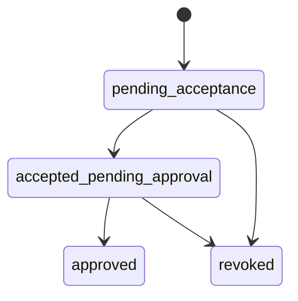
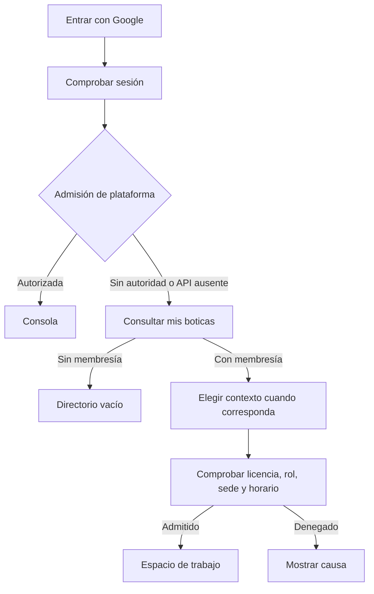

# Acceso y estructura

**Corte vigente.** Las etiquetas por UC incorporan [RUN-10](../VALIDATION.md#run-10). La columna de aserciones delimita el escenario ejecutado. Las recetas AS-IS describen el diagnóstico anterior. [Decisiones de diseño](../TO_BE.md).

[Validación RFA2](../VALIDATION.md) · SC-10. E2 identifica la frontera con dobles o pruebas locales. BLOCKED indica una frontera esencial sin evidencia aislada.

Roles comerciales persistidos Owner/Pharmacist/Cashier (`TenantRole.cs:3–7`). Superadmin se admite aparte. El menú es visibilidad, y el servidor determina tenant, licencia, membresía y horario. Autenticación bajo configuración Google y session gate. Ver el [recorrido propuesto](../TO_BE.md).

## UC-ACC-01

GET `/api/tenants/{tenantId}/employees` · `backend/src/MediPOS.Api/Tenant/EmployeeEndpoints.cs:16`. **E3 · IMPLEMENTADO · BLOCKED**. Como Owner abre Personal y pagina integrantes. EmployeeEndpoints.cs:16 y EmployeeDirectoryQueries validan administración; EmployeeDirectoryReader.cs:10–21 selecciona tenant, combina membresías, nombre, sedes y horarios y entrega proyección por integrante. Reconsulta tras cambios de la ficha.

## UC-ACC-02

POST `/api/tenants/{tenantId}/employees` · `backend/src/MediPOS.Api/Tenant/EmployeeEndpoints.cs:18`. **E2 · NO_EXPUESTO · PASS**. El endpoint de alta directa existe, pero conserva el conflicto invitation_required; UI utiliza invitación. EmployeeEndpoints.cs:18–23 y EmployeeInvitationHandler.cs:19. No se crea un empleado desde alta directa normal.

## UC-ACC-03

POST `/api/tenants/{tenantId}/employees/{membershipId}/deactivate` · `backend/src/MediPOS.Api/Tenant/EmployeeEndpoints.cs:24`. **E3 · IMPLEMENTADO · PASS**. Selecciona integrante y confirma desactivación. DeactivateMembershipHandler.cs:18–45 revalida administración en el alcance de licencia, verifica que queda un Owner y conserva historial. TenantLicenseProvisioning.cs:12–31 bloquea licencia; IdentityAccessStore.cs:64–76 guarda estado y auditoría. Relee integrante antes de repetir si se pierde respuesta.

## UC-ACC-04

PUT `/api/tenants/{tenantId}/employees/{membershipId}/branches` · `backend/src/MediPOS.Api/Tenant/EmployeeEndpoints.cs:29`. **E3 · IMPLEMENTADO · BLOCKED**. Edita las sucursales permitidas de un integrante. EmployeeEndpoints.cs:29–34 entrega IDs a SetMembershipBranchesHandler, con administración y pertenencia de las sedes al tenant. IdentityAccessStore.cs:79–92 reemplaza el conjunto por membresía y guarda auditoría; 204, reconsulta al mismo integrante. No se altera el rol.

## UC-ACC-05

PUT `/api/tenants/{tenantId}/employees/{membershipId}/schedule` · `backend/src/MediPOS.Api/Tenant/EmployeeEndpoints.cs:35`. **E3 · IMPLEMENTADO · BLOCKED**. Edita ventanas por día en ficha y guarda. EmployeeEndpoints.cs:35–40 y ReplaceWorkScheduleHandler.cs:19–51 verifican administración y construyen ventanas válidas para el miembro. IdentityAccessStore.cs:96–109 reemplaza work_schedules y audita. 204 permite releer ficha; la admisión posterior vuelve a evaluar horario.

## UC-ACC-06

GET `/api/tenants/{tenantId}/employee-invitations/{invitationId}` · `backend/src/MediPOS.Api/Tenant/EmployeeInvitationEndpoints.cs:13`. **E3 · IMPLEMENTADO · BLOCKED**. Abre la invitación original para consultar su estado. EmployeeInvitationHandler.cs:25–33 exige administración antes/después; EmployeeInvitationStore.cs:13–21 establece ámbito Owner y proyecta invitación por tenant/ID con versión. Mantener el ID si la lectura falla.

## UC-ACC-07

GET `/api/tenants/{tenantId}/employee-invitations` · `backend/src/MediPOS.Api/Tenant/EmployeeInvitationEndpoints.cs:16`. **E2 · IMPLEMENTADO · BLOCKED**. Abre Invitaciones, pagina o busca por intención original. EmployeeInvitationHandler.cs:35–43 y EmployeeInvitationStore.cs:24–36 validan Owner, filtran tenant y, para clientRequestId, restringen a su membresía emisora. El listado permite recuperar estado sin volver a emitir el secreto.

## UC-ACC-08

POST `/api/tenants/{tenantId}/employee-invitations` · `backend/src/MediPOS.Api/Tenant/EmployeeInvitationEndpoints.cs:19`. **E3 · IMPLEMENTADO · BLOCKED**. Selecciona rol y genera invitación; copia enlace cuando la respuesta lo incluye. EmployeeInvitationsPanel.tsx:49–63 conserva intención; EmployeeInvitationHandler.cs:48–65 comprueba administración/licencia y repeticiones. EmployeeInvitationStore.cs:39–50,78–90 guarda hash y auditoría, sin almacenar enlace recuperable. Ante incertidumbre busca el clientRequestId original en UC-ACC-07.

## UC-ACC-09

POST `/api/tenants/{tenantId}/employee-invitations/{invitationId}/approve` · `backend/src/MediPOS.Api/Tenant/EmployeeInvitationEndpoints.cs:31`. **E3 · IMPLEMENTADO · BLOCKED**. Tras la aceptación, revisa identidad y confirma aprobación. EmployeeInvitationHandler.cs:85–112 exige administración, coincidencia de versión y aceptación vigente; EmployeeInvitationStore.cs:53–64,78–90 bloquea invitación y persiste decisión y auditoría. MembershipProvisioning crea membresía en el alcance de la operación. Una aprobación repetida requiere la versión original; consulta el mismo ID si fue incierta.

## UC-ACC-10

POST `/api/tenants/{tenantId}/employee-invitations/{invitationId}/revoke` · `backend/src/MediPOS.Api/Tenant/EmployeeInvitationEndpoints.cs:36`. **E3 · IMPLEMENTADO · BLOCKED**. Desde detalle, introduce motivo y revoca. EmployeeInvitationHandler.cs:114–130 comprueba administración, versión y transición; EmployeeInvitationStore.cs:53–64,78–90 bloquea y guarda auditoría. La lectura del mismo ID permite verificar el estado sin revocar una membresía ya creada.

## UC-ACC-11

POST `/api/employee-invitations/accept` · `backend/src/MediPOS.Api/Tenant/EmployeeInvitationEndpoints.cs:42`. **E3 · IMPLEMENTADO · BLOCKED**. Abre el enlace, autentícate y pulsa aceptar. AcceptInvitationPage retira fragmento; EmployeeInvitationEndpoints.cs:42 y EmployeeInvitationHandler.cs:67–82 usan identidad autenticada y secreto verificado. EmployeeInvitationStore.cs:66–90,106 bloquea la invitación en transacción, guarda aceptación y audita. Respuesta pendiente de aprobación; el ingreso aún no concede membresía.

## UC-ACC-12

GET `/auth/csrf` · `backend/src/MediPOS.Api/Authentication/GoogleAuthenticationRegistration.cs:186`. **E2 · IMPLEMENTADO · BLOCKED**. Cliente obtiene token antes de mutación (frontend/src/shared/api/http.ts:81–90,140–143); GoogleAuthenticationRegistration.cs:186–187 emite respuesta. Es control de transporte, sin modificación comercial.

## UC-ACC-13

POST `/auth/login` · `backend/src/MediPOS.Api/Authentication/GoogleAuthenticationRegistration.cs:188`. **E2 · IMPLEMENTADO · BLOCKED**. Pulsar Continuar con Google. HttpClient.login crea formulario top-level con CSRF y GoogleAuthenticationRegistration.cs:188–195 inicia challenge. Callback UC-ACC-14.

## UC-ACC-14

GET `/auth/google/callback` · `backend/src/MediPOS.Api/Authentication/GoogleAuthenticationRegistration.cs:197`. **E2 · IMPLEMENTADO · BLOCKED**. Consumir callback registrado; el fallback devuelve fallo 401 si no se completó por middleware. Configuración de sesión y resolución de identidad persistida requieren cerrar el rastreo de eventos. GoogleAuthenticationRegistration.cs:101,197 registra eventos y ruta de callback. GoogleAuthenticationEvents.cs:6–24 obtiene identidad verificada, UpsertGoogleUserHandler.cs:17–18 persiste usuario y dispara reclamo si aplica. IdentityAccessStore.cs:12–25 guarda identidad; se crea principal con ID interno y la sesión normal usa ticket server-side (Registration:103).

## UC-ACC-15

GET `/auth/me` · `backend/src/MediPOS.Api/Authentication/GoogleAuthenticationRegistration.cs:199`. **E2 · IMPLEMENTADO · BLOCKED**. Tras login o recarga, React consulta sesión. GoogleAuthenticationRegistration.cs:57–65,103,166–177,199–204 exige HTTPS/origen y sesión; ServerSessionTicketStore.cs:12–37 guarda tickets en memoria y solo recupera vigentes. Devuelve identidad de sesión, sin conceder botica ni plataforma. 401 requiere ingresar de nuevo.

## UC-ACC-16

POST `/auth/logout` · `backend/src/MediPOS.Api/Authentication/GoogleAuthenticationRegistration.cs:205`. **E2 · IMPLEMENTADO · BLOCKED**. Pulsa Cerrar sesión. GoogleAuthenticationRegistration.cs:205–209 verifica CSRF y firma salida del esquema; ServerSessionTicketStore.cs:37 elimina ticket en memoria. La UI borra el contexto de la cuenta y la comprobación posterior es UC-ACC-15.

## UC-ACC-17

GET `/api/me/tenants` · `backend/src/MediPOS.Api/Tenant/TenantEndpoints.cs:16`. **E3 · IMPLEMENTADO · BLOCKED**. Después de ingresar, elige botica si hay varias; el directorio vacío no concede acceso. TenantEndpoints.cs:16 y ListMyTenantsHandler toman usuario de sesión. MyTenantDirectoryReader.cs:12–37 fija discovery_user_id en transacción y pagina membresías activas enlazadas a tenants. La autorización efectiva se verifica aparte en UC-ACC-18.

## UC-ACC-18

GET `/api/tenants/{tenantId}/access` · `backend/src/MediPOS.Api/Tenant/TenantEndpoints.cs:20`. **E3 · IMPLEMENTADO · BLOCKED**. Al abrir o cambiar botica/sede, verifica acceso antes de entrar. ResolveAccessContextHandler.cs:6–19 usa sesión; OperationalAccessReader.cs:10–40 selecciona tenant y compone membresía, licencia, sede asignada y horario bajo alcance RLS. EvaluateOperationalAccess.cs:36–58 decide causas de rechazo o admisión, incluidas excepciones Owner. React revalida al cambiar contexto.

## UC-ACC-19

GET `/api/tenants/{tenantId}/branches` · `backend/src/MediPOS.Api/Tenant/TenantEndpoints.cs:23`. **E3 · IMPLEMENTADO · BLOCKED**. Elige sede si hay más de una habilitada. BranchDirectoryQueries.cs:16–31 revalida sesión/membresía y limita a asignadas si no es Owner; BranchDirectoryReader.cs:10–16 aplica ámbito tenant y pagina. Cada elección vuelve a UC-ACC-18 para validar el acceso efectivo.

## UC-ACC-20

GET `/api/tenants/{tenantId}/legal-entities` · `backend/src/MediPOS.Api/Tenant/TenantEndpoints.cs:26`. **E3 · IMPLEMENTADO · BLOCKED**. En Configuración consulta entidades y elige una existente cuando corresponda. TenantStructure.tsx:53–61 y TenantEndpoints.cs:26 invocan BranchDirectoryQueries.cs:38–41 con administración antes/después. BranchDirectoryReader.cs:18–22 proyecta razón social/RUC por tenant y pagina. No crea una segunda entidad al seleccionar.

## UC-ACC-21

GET `/api/tenants/{tenantId}/license` · `backend/src/MediPOS.Api/Tenant/TenantEndpoints.cs:29`. **E2 · IMPLEMENTADO · BLOCKED**. Abre la licencia en Configuración. BranchDirectoryQueries.cs:43–48 exige administración; BranchDirectoryReader.cs:24–30 lee licencia del ámbito tenant y TenantStructure.tsx:53 y siguientes proyecta vigencia. Diferenciar vencimiento mostrado de un cambio de estado; una lectura no renueva.

## UC-ACC-22

POST `/api/tenants/{tenantId}/legal-entities` · `backend/src/MediPOS.Api/Tenant/TenantEndpoints.cs:31`. **E3 · IMPLEMENTADO · BLOCKED**. Como Owner registra razón social y RUC solo si no dispone de entidad. CreateLegalEntityHandler.cs:15–33 verifica administración y licencia y construye la entidad; BranchesStore.cs:43–48 guarda entidad/auditoría en alcance de provisión. Respuesta permite reutilizar ID para sucursal. Si se pierde, revisar directorio y conciliar sin inferir coincidencia por nombre.

## UC-ACC-23

POST `/api/tenants/{tenantId}/branches` · `backend/src/MediPOS.Api/Tenant/TenantEndpoints.cs:36`. **E3 · IMPLEMENTADO · BLOCKED**. Selecciona entidad, escribe nombre de sede y guarda. TenantStructure.tsx:67–100 y CreateBranchHandler.cs:15–37 validan administración, vínculo y cupo bajo bloqueo de licencia (TenantLicenseProvisioning.cs:12–31); BranchesStore.cs:51–57 guarda sede/auditoría. Ante alta confirmada revalida acceso; ante pérdida contrasta sede creada y no duplica entidad.

## UC-ACC-24

GET `/api/tenants/{tenantId}/branches/{branchId}/operations/{requestId}` · `backend/src/MediPOS.Api/Tenant/TenantEndpoints.cs:41`. **E3 · IMPLEMENTADO · BLOCKED**. Consultar constancia original desde flujos recuperables. shared/api/operations.ts:7 y TenantEndpoints.cs:41–43 validan ID/resultado/kind en ámbito. Confirmar cada política de actor y rama SQL de lectura. RecoverableOperations.cs:30–35 requiere acceso ProductSearch del actor, filtra tenant/sede/actor/membresía/requestId en tenant_operation_receipts. ExecuteAsync:39–101 aplica política por tipo, hash/intención y guarda acuse con commit. Migración 20261027043336:59 fuerza RLS. Frontend verifica clase original en operations.ts:7 y siguientes.

## UC-ACC-25

Elegir o cambiar botica y sede. **E2 · IMPLEMENTADO · BLOCKED**. Elegir o cambiar botica/sede solo cuando hay más de una opción; cada opción navega al contexto validado por servidor. TenantSelection/BranchSelection y WorkspaceLayout. Las escrituras pendientes se rigen por protección de navegación. Estado comercial depende de UC-ACC-18.

## UC-ACC-26

Primera sede y entrada automática. **E2 · IMPLEMENTADO · BLOCKED**. Owner prepara primera sede desde configuración. Entidad existente se reutiliza, el alta confirmada de entidad puede continuar con la sede. TenantStructure.tsx:67–100,186–223; si falla segunda parte se conserva primero confirmado, verificar inicialmente con UC-ACC-22/23.

## UC-ACC-27

 `` · ``. **E3 · IMPLEMENTADO · BLOCKED**. Usar el Gmail designado y verificado. GoogleAuthenticationEvents.cs:16–23 y UpsertGoogleUserHandler.cs:17–18 enlazan login y reclamo. InitialOwnerInvitations.cs:78–97 verifica email, sujeto, licencia, condición de primer Owner y persistencia de membresía/invitación. Si no cumple, no obtiene acceso de Owner; la siguiente consulta de directorio usa la sesión resultante.

## Admisión tras el ingreso

## Fuentes

- [TenantRole.cs](../../../../backend/src/MediPOS.Domain/Modules/IdentityAccess/TenantRole.cs)
- [EmployeeEndpoints.cs](../../../../backend/src/MediPOS.Api/Tenant/EmployeeEndpoints.cs)
- [EmployeeInvitationHandler.cs](../../../../backend/src/MediPOS.Application/Modules/IdentityAccess/Invitations/EmployeeInvitationHandler.cs)
- [EmployeeInvitationEndpoints.cs](../../../../backend/src/MediPOS.Api/Tenant/EmployeeInvitationEndpoints.cs)
- [EmployeeInvitationsPanel.tsx](../../../../frontend/src/features/employees/EmployeeInvitationsPanel.tsx)
- [GoogleAuthenticationRegistration.cs](../../../../backend/src/MediPOS.Api/Authentication/GoogleAuthenticationRegistration.cs)
- [http.ts](../../../../frontend/src/shared/api/http.ts)
- [GoogleAuthenticationEvents.cs](../../../../backend/src/MediPOS.Api/Authentication/GoogleAuthenticationEvents.cs)
- [UpsertGoogleUserHandler.cs](../../../../backend/src/MediPOS.Application/Modules/IdentityAccess/UpsertGoogleUser/UpsertGoogleUserHandler.cs)
- [IdentityAccessStore.cs](../../../../backend/src/MediPOS.Infrastructure/Modules/IdentityAccess/Persistence/IdentityAccessStore.cs)
- [TenantEndpoints.cs](../../../../backend/src/MediPOS.Api/Tenant/TenantEndpoints.cs)
- [TenantStructure.tsx](../../../../frontend/src/features/settings/TenantStructure.tsx)
- [operations.ts](../../../../frontend/src/shared/api/operations.ts)
- [RecoverableOperations.cs](../../../../backend/src/MediPOS.Infrastructure/Persistence/RecoverableOperations.cs)
- [InitialOwnerInvitations.cs](../../../../backend/src/MediPOS.Application/Modules/IdentityAccess/Invitations/InitialOwnerInvitations.cs)
- [InitialOwnerInvitationStore.cs](../../../../backend/src/MediPOS.Infrastructure/Modules/IdentityAccess/Persistence/InitialOwnerInvitationStore.cs)
- [InitialOwnerInvitationSql.cs](../../../../backend/src/MediPOS.Infrastructure/Modules/IdentityAccess/Persistence/InitialOwnerInvitationSql.cs)
- [Prueba relacionada de la familia](../../../../backend/tests/MediPOS.UnitTests/Api/EmployeeInvitationHttpTests.cs) · E0 de ejecución, se inventaría por contexto; no atribuir cobertura de todas las variantes.

- [ResolveAccessContextHandler.cs](../../../../backend/src/MediPOS.Application/Modules/IdentityAccess/OperationalAccess/ResolveAccessContextHandler.cs)
- [EvaluateOperationalAccess.cs](../../../../backend/src/MediPOS.Application/Modules/IdentityAccess/OperationalAccess/EvaluateOperationalAccess.cs)
