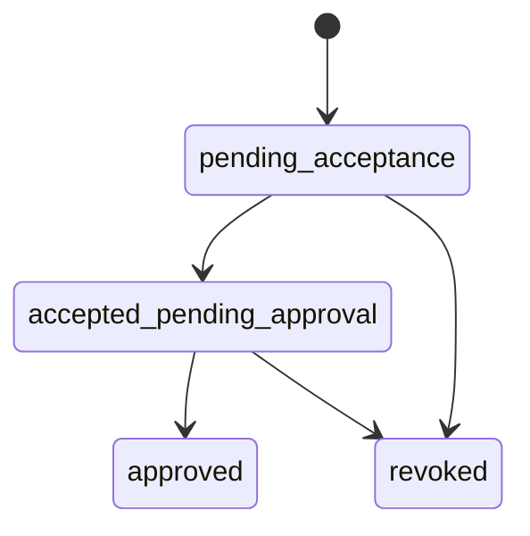

# Acceso y estructura

Roles comerciales persistidos Owner/Pharmacist/Cashier (`TenantRole.cs:3–7`). Superadmin se admite aparte. El menú es visibilidad, y el servidor determina tenant, licencia, membresía y horario. Autenticación bajo configuración Google y session gate. TO-BE PENDIENTE_RFA3.

## UC-ACC-01

GET `/api/tenants/{tenantId}/employees` · `backend/src/MediPOS.Api/Tenant/EmployeeEndpoints.cs:16`. **E0 · IMPLEMENTADO · NOT_RUN**. Abrir Personal, consultar integrantes y datos de sede/horario. EmployeeDirectoryQueries desde EmployeeEndpoints.cs:16. EF de proyección pendiente.

## UC-ACC-02

POST `/api/tenants/{tenantId}/employees` · `backend/src/MediPOS.Api/Tenant/EmployeeEndpoints.cs:18`. **E1 · NO_EXPUESTO · NOT_RUN**. El endpoint de alta directa existe, pero conserva el conflicto invitation_required; UI utiliza invitación. EmployeeEndpoints.cs:18–23 y EmployeeInvitationHandler.cs:19. No se crea un empleado desde alta directa normal.

## UC-ACC-03

POST `/api/tenants/{tenantId}/employees/{membershipId}/deactivate` · `backend/src/MediPOS.Api/Tenant/EmployeeEndpoints.cs:24`. **E0 · IMPLEMENTADO · NOT_RUN**. Seleccionar integrante y solicitar desactivación. EmployeeEndpoints.cs:24–28 → DeactivateMembershipHandler; revalidación/refresco en useEmployeeWrite. Candado último Owner por completar.

## UC-ACC-04

PUT `/api/tenants/{tenantId}/employees/{membershipId}/branches` · `backend/src/MediPOS.Api/Tenant/EmployeeEndpoints.cs:29`. **E0 · IMPLEMENTADO · NOT_RUN**. Editar sucursales en ficha y guardar conjunto. EmployeeEndpoints.cs:29–34 retorna 204; se reconsulta integrante y preserva intención incierta. Reglas y tablas de asignaciones pendientes.

## UC-ACC-05

PUT `/api/tenants/{tenantId}/employees/{membershipId}/schedule` · `backend/src/MediPOS.Api/Tenant/EmployeeEndpoints.cs:35`. **E0 · IMPLEMENTADO · NOT_RUN**. Editar ventanas de trabajo en ficha y guardar. EmployeeEndpoints.cs:35–40 y ReplaceWorkScheduleHandler; restricciones del store y autorización exacta pendiente.

## UC-ACC-06

GET `/api/tenants/{tenantId}/employee-invitations/{invitationId}` · `backend/src/MediPOS.Api/Tenant/EmployeeInvitationEndpoints.cs:13`. **E0 · IMPLEMENTADO · NOT_RUN**. Reconsultar invitación original por ID para acción incierta. EmployeeInvitationHandler.cs:25–33 revalida administración antes y después de leer. Persistencia por completar.

## UC-ACC-07

GET `/api/tenants/{tenantId}/employee-invitations` · `backend/src/MediPOS.Api/Tenant/EmployeeInvitationEndpoints.cs:16`. **E0 · IMPLEMENTADO · NOT_RUN**. Abrir pestaña Invitaciones y paginar o buscar intención original. EmployeeInvitationHandler.cs:35–43. Store por completar.

## UC-ACC-08

POST `/api/tenants/{tenantId}/employee-invitations` · `backend/src/MediPOS.Api/Tenant/EmployeeInvitationEndpoints.cs:19`. **E0 · IMPLEMENTADO · NOT_RUN**. Invitar, seleccionar rol y copiar enlace temporal una sola vez. EmployeeInvitationsPanel.tsx:49–63 y EmployeeInvitationHandler.cs:48–81 conservan intención y guardan en ámbito. Verificación de row/policy exactas pendiente.

## UC-ACC-09

POST `/api/tenants/{tenantId}/employee-invitations/{invitationId}/approve` · `backend/src/MediPOS.Api/Tenant/EmployeeInvitationEndpoints.cs:31`. **E0 · IMPLEMENTADO · NOT_RUN**. Tras aceptación Google, verificar identidad independiente y aprobar con versión. EmployeeInvitationHandler.cs:89–113 exige estado aceptado, vigencia y actor. Concurrencia y datos persistidos por completar.

## UC-ACC-10

POST `/api/tenants/{tenantId}/employee-invitations/{invitationId}/revoke` · `backend/src/MediPOS.Api/Tenant/EmployeeInvitationEndpoints.cs:36`. **E0 · IMPLEMENTADO · NOT_RUN**. Revocar con motivo desde detalle. EmployeeInvitationHandler.cs:116–129 usa autorización de administración; resultado incierto recupera la misma invitación. Efectos SQL por completar.

## UC-ACC-11

POST `/api/employee-invitations/accept` · `backend/src/MediPOS.Api/Tenant/EmployeeInvitationEndpoints.cs:42`. **E0 · IMPLEMENTADO · NOT_RUN**. Abrir enlace, autenticarse y aceptar conscientemente. AcceptInvitationPage usa fragmento y lo retira. POST con ticket devuelve aceptación pendiente de aprobación. Store de uso único pendiente.

## UC-ACC-12

GET `/auth/csrf` · `backend/src/MediPOS.Api/Authentication/GoogleAuthenticationRegistration.cs:186`. **E1 · IMPLEMENTADO · NOT_RUN**. Cliente obtiene token antes de mutación (frontend/src/shared/api/http.ts:81–90,140–143); GoogleAuthenticationRegistration.cs:186–187 emite respuesta. Es control de transporte, sin modificación comercial.

## UC-ACC-13

POST `/auth/login` · `backend/src/MediPOS.Api/Authentication/GoogleAuthenticationRegistration.cs:188`. **E1 · IMPLEMENTADO · NOT_RUN**. Pulsar Continuar con Google. HttpClient.login crea formulario top-level con CSRF y GoogleAuthenticationRegistration.cs:188–195 inicia challenge. Callback UC-ACC-14.

## UC-ACC-14

GET `/auth/google/callback` · `backend/src/MediPOS.Api/Authentication/GoogleAuthenticationRegistration.cs:197`. **E1 · IMPLEMENTADO · NOT_RUN**. Consumir callback registrado; el fallback devuelve fallo 401 si no se completó por middleware. Configuración de sesión y resolución de identidad persistida requieren cerrar el rastreo de eventos. GoogleAuthenticationRegistration.cs:101,197 registra eventos y ruta de callback. GoogleAuthenticationEvents.cs:6–24 obtiene identidad verificada, UpsertGoogleUserHandler.cs:17–18 persiste usuario y dispara reclamo si aplica. IdentityAccessStore.cs:12–25 guarda identidad; se crea principal con ID interno y la sesión normal usa ticket server-side (Registration:103).

## UC-ACC-15

GET `/auth/me` · `backend/src/MediPOS.Api/Authentication/GoogleAuthenticationRegistration.cs:199`. **E0 · IMPLEMENTADO · NOT_RUN**. Leer sesión actual desde React, cookies y origen en backend. GoogleAuthenticationRegistration.cs:199–204. Duración y revocación en store pendientes.

## UC-ACC-16

POST `/auth/logout` · `backend/src/MediPOS.Api/Authentication/GoogleAuthenticationRegistration.cs:205`. **E0 · IMPLEMENTADO · NOT_RUN**. Elegir Cerrar sesión. GoogleAuthenticationRegistration.cs:205–209 revoca el esquema de sesión. Verificación de store tras logout pendiente.

## UC-ACC-17

GET `/api/me/tenants` · `backend/src/MediPOS.Api/Tenant/TenantEndpoints.cs:16`. **E0 · IMPLEMENTADO · NOT_RUN**. Tras ingreso, cargar boticas de la membresía. ListMyTenantsHandler y MyTenantDirectoryReader sirven página del actor. El directorio alimenta TenantSelection, la autorización efectiva sigue siendo una lectura separada por contexto. El cursor no concede acceso.

## UC-ACC-18

GET `/api/tenants/{tenantId}/access` · `backend/src/MediPOS.Api/Tenant/TenantEndpoints.cs:20`. **E0 · IMPLEMENTADO · NOT_RUN**. Validar tenant, estado de membresía, licencia y sucursal/horario antes del workspace. ResolveAccessContextHandler.cs:6–19 combina identidad de sesión con snapshot persistido y EvaluateOperationalAccess.cs:36–58 determina licencia, asignación y horario, con excepción de Owner donde corresponde. Body de lector de snapshot y RLS específico siguen pendientes.

## UC-ACC-19

GET `/api/tenants/{tenantId}/branches` · `backend/src/MediPOS.Api/Tenant/TenantEndpoints.cs:23`. **E0 · IMPLEMENTADO · NOT_RUN**. Consultar sedes y elegir cuando existe decisión. BranchDirectoryQueries devuelve directorio y WorkspaceLayout vuelve a verificar acceso. SQL por revisar.

## UC-ACC-20

GET `/api/tenants/{tenantId}/legal-entities` · `backend/src/MediPOS.Api/Tenant/TenantEndpoints.cs:26`. **E0 · IMPLEMENTADO · NOT_RUN**. En Configuración, consultar entidades de la botica. BranchDirectoryQueries y TenantStructure.tsx:53–61. Proyección EF por revisar.

## UC-ACC-21

GET `/api/tenants/{tenantId}/license` · `backend/src/MediPOS.Api/Tenant/TenantEndpoints.cs:29`. **E0 · IMPLEMENTADO · NOT_RUN**. Leer licencia desde Configuración/primera sede. TenantStructure.tsx:53 reconsulta por scope. El badge puede indicar vencimiento sin cambiar el estado persistido. Backend reader pendiente.

## UC-ACC-22

POST `/api/tenants/{tenantId}/legal-entities` · `backend/src/MediPOS.Api/Tenant/TenantEndpoints.cs:31`. **E0 · IMPLEMENTADO · NOT_RUN**. Registrar razón social y RUC solo si hace falta. TenantEndpoints.cs:31–35 y :64. Si se pierde acuse, no inventar equivalencia fiscal. Handler/EF por completar.

## UC-ACC-23

POST `/api/tenants/{tenantId}/branches` · `backend/src/MediPOS.Api/Tenant/TenantEndpoints.cs:36`. **E0 · IMPLEMENTADO · NOT_RUN**. Crear sede con entidad legal, nombre y cupo vigente. TenantStructure.tsx:67–100 vuelve a verificar admisión; TenantEndpoints.cs:36–40 y :65. Transacción/cupo concurrente por rastrear.

## UC-ACC-24

GET `/api/tenants/{tenantId}/branches/{branchId}/operations/{requestId}` · `backend/src/MediPOS.Api/Tenant/TenantEndpoints.cs:41`. **E1 · IMPLEMENTADO · NOT_RUN**. Consultar constancia original desde flujos recuperables. shared/api/operations.ts:7 y TenantEndpoints.cs:41–43 validan ID/resultado/kind en ámbito. Confirmar cada política de actor y rama SQL de lectura. RecoverableOperations.cs:30–35 requiere acceso ProductSearch del actor, filtra tenant/sede/actor/membresía/requestId en tenant_operation_receipts. ExecuteAsync:39–101 aplica política por tipo, hash/intención y guarda acuse con commit. Migración 20261027043336:59 fuerza RLS. Frontend verifica clase original en operations.ts:7 y siguientes.

## UC-ACC-25

Elegir o cambiar botica y sede. **E1 · IMPLEMENTADO · NOT_RUN**. Elegir o cambiar botica/sede solo cuando hay más de una opción; cada opción navega al contexto validado por servidor. TenantSelection/BranchSelection y WorkspaceLayout. Las escrituras pendientes se rigen por protección de navegación. Estado comercial depende de UC-ACC-18.

## UC-ACC-26

Primera sede y entrada automática. **E1 · IMPLEMENTADO · NOT_RUN**. Owner prepara primera sede desde configuración. Entidad existente se reutiliza, el alta confirmada de entidad puede continuar con la sede. TenantStructure.tsx:67–100,186–223; si falla segunda parte se conserva primero confirmado, verificar inicialmente con UC-ACC-22/23.

## UC-ACC-27

 `` · ``. **E1 · IMPLEMENTADO · NOT_RUN**. Usar el Gmail designado y verificado. GoogleAuthenticationEvents.cs:16–23 y UpsertGoogleUserHandler.cs:17–18 enlazan login y reclamo. InitialOwnerInvitations.cs:78–97 verifica email, sujeto, licencia, condición de primer Owner y persistencia de membresía/invitación. Si no cumple, no obtiene acceso de Owner; la siguiente consulta de directorio usa la sesión resultante.

## Fuentes

- [TenantRole.cs](../../../../backend/src/MediPOS.Domain/Modules/IdentityAccess/TenantRole.cs)
- [EmployeeEndpoints.cs](../../../../backend/src/MediPOS.Api/Tenant/EmployeeEndpoints.cs)
- [EmployeeInvitationHandler.cs](../../../../backend/src/MediPOS.Application/Modules/IdentityAccess/Invitations/EmployeeInvitationHandler.cs)
- [EmployeeInvitationEndpoints.cs](../../../../backend/src/MediPOS.Api/Tenant/EmployeeInvitationEndpoints.cs)
- [EmployeeInvitationsPanel.tsx](../../../../frontend/src/features/employees/EmployeeInvitationsPanel.tsx)
- [GoogleAuthenticationRegistration.cs](../../../../backend/src/MediPOS.Api/Authentication/GoogleAuthenticationRegistration.cs)
- [http.ts](../../../../frontend/src/shared/api/http.ts)
- [GoogleAuthenticationEvents.cs](../../../../backend/src/MediPOS.Api/Authentication/GoogleAuthenticationEvents.cs)
- [UpsertGoogleUserHandler.cs](../../../../backend/src/MediPOS.Application/Modules/IdentityAccess/UpsertGoogleUser/UpsertGoogleUserHandler.cs)
- [IdentityAccessStore.cs](../../../../backend/src/MediPOS.Infrastructure/Modules/IdentityAccess/Persistence/IdentityAccessStore.cs)
- [TenantEndpoints.cs](../../../../backend/src/MediPOS.Api/Tenant/TenantEndpoints.cs)
- [TenantStructure.tsx](../../../../frontend/src/features/settings/TenantStructure.tsx)
- [operations.ts](../../../../frontend/src/shared/api/operations.ts)
- [RecoverableOperations.cs](../../../../backend/src/MediPOS.Infrastructure/Persistence/RecoverableOperations.cs)
- [InitialOwnerInvitations.cs](../../../../backend/src/MediPOS.Application/Modules/IdentityAccess/Invitations/InitialOwnerInvitations.cs)
- [InitialOwnerInvitationStore.cs](../../../../backend/src/MediPOS.Infrastructure/Modules/IdentityAccess/Persistence/InitialOwnerInvitationStore.cs)
- [InitialOwnerInvitationSql.cs](../../../../backend/src/MediPOS.Infrastructure/Modules/IdentityAccess/Persistence/InitialOwnerInvitationSql.cs)
- [Prueba relacionada de la familia](../../../../backend/tests/MediPOS.UnitTests/Api/EmployeeInvitationHttpTests.cs) · E0 de ejecución, se inventaría por contexto; no atribuir cobertura de todas las variantes.

- [ResolveAccessContextHandler.cs](../../../../backend/src/MediPOS.Application/Modules/IdentityAccess/OperationalAccess/ResolveAccessContextHandler.cs)
- [EvaluateOperationalAccess.cs](../../../../backend/src/MediPOS.Application/Modules/IdentityAccess/OperationalAccess/EvaluateOperationalAccess.cs)
