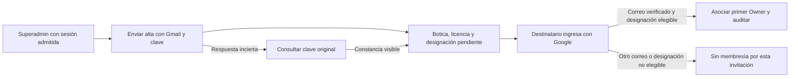

# Plataforma

**Corte vigente.** Las etiquetas por UC incorporan [RUN-10](../VALIDATION.md#run-10). La columna de aserciones delimita el escenario ejecutado. Las recetas AS-IS describen el diagnóstico anterior. [Decisiones de diseño](../TO_BE.md).

[Validación RFA2](../VALIDATION.md) · SC-11. E2 identifica la frontera con dobles o pruebas locales. BLOCKED indica una frontera esencial sin evidencia aislada.

Seis áreas en `PlatformPage.tsx:24–32`. Allowlist privada de UUID y sesión independientes de Owner. `Program.cs:28–31,55–57` compone flags. `PlatformDirectoryEndpoints.cs:52–63` exige autoridad, tipo de rate lease y validación de consulta; UI distingue 429, denegación y conflicto. Ver el [recorrido propuesto](../TO_BE.md).

## UC-PLA-01

GET `/platform/catalog/categories` · `backend/src/MediPOS.Api/Platform/PlatformDirectoryEndpoints.cs:13`. **E3 · IMPLEMENTADO · BLOCKED**. En Catálogo global abre categorías. PlatformDirectoryEndpoints.cs:13–21 valida límite y autoridad de plataforma; PlatformCategoryQueries.cs:9 en adelante llama CatalogDirectoryReader para categorías de administración. La lista alimenta tarjetas; una consulta fallida no modifica categorías.

## UC-PLA-02

GET `/platform/session` · `backend/src/MediPOS.Api/Platform/PlatformDirectoryEndpoints.cs:22`. **E2 · IMPLEMENTADO · BLOCKED**. Entrar a plataforma o resolver destino al login. /platform/session exige autoridad (PlatformDirectoryEndpoints.cs:22,52–63), 404 si no se mapea, distinto de denegación. Consulta de admisión sin escritura.

## UC-PLA-03

GET `/platform/tenants` · `backend/src/MediPOS.Api/Platform/PlatformDirectoryEndpoints.cs:24`. **E3 · IMPLEMENTADO · BLOCKED**. Abre Boticas, Propietarios o Licencias y avanza por cursor. usePlatformConsole.ts:42 y PlatformDirectoryQueries.cs:24–30 validan autoridad; PlatformDirectoryReader.cs:15–55 ordena tenant por ID y proyecta su administración con el ámbito de cada tenant. La lista no concede acceso a operaciones comerciales.

## UC-PLA-04

GET `/platform/tenants/{tenantId:guid}/details` · `backend/src/MediPOS.Api/Platform/PlatformDirectoryEndpoints.cs:33`. **E3 · IMPLEMENTADO · BLOCKED**. Selecciona una botica para ver licencia y estado de titular. usePlatformConsole.ts:43–44 y PlatformDirectoryQueries.cs:33–39 resuelven detalle; PlatformDirectoryReader.cs:58–66 consulta tenant/licencia y primer Owner histórico bajo ámbito seleccionado. Se consulta invitación por separado cuando aplica.

## UC-PLA-05

GET `/platform/identities/{userId}` · `backend/src/MediPOS.Api/Platform/PlatformDirectoryEndpoints.cs:39`. **E3 · NO_EXPUESTO · BLOCKED**. En un cliente de compatibilidad consulta una identidad por UUID interno. PlatformDirectoryEndpoints.cs:39–43 y PlatformDirectoryQueries.cs:42–48 requieren Superadmin; PlatformDirectoryReader.cs:69–71 solo proyecta identidad Google existente. La UI de alta por Gmail no usa esta ruta, y la consulta no concede autoridad.

## UC-PLA-06

GET `/platform/tenant-requests/{requestKey}` · `backend/src/MediPOS.Api/Platform/PlatformDirectoryEndpoints.cs:43`. **E3 · IMPLEMENTADO · PASS**. Ante alta incierta, consulta la constancia con la clave original. usePlatformConsole.ts:152–173 contrasta resultado y cierra antes del refresco; PlatformDirectoryQueries.cs:51–57 y PlatformDirectoryReader.cs:73 en adelante verifican actor/clave y leen resultado de creación. Un error al refrescar directorio no revierte confirmación.

## UC-PLA-07

GET `/platform/tenants/{tenantId}/initial-owner` · `backend/src/MediPOS.Api/Platform/PlatformInitialOwnerEndpoints.cs:12`. **E3 · IMPLEMENTADO · BLOCKED**. Abre detalle para ver asignación inicial. PlatformInitialOwnerEndpoints.cs:12 y usePlatformConsole.ts:44 consultan por tenant bajo autoridad de plataforma. InitialOwnerInvitationStore.cs:42–54 usa ámbito de plataforma y ordena el registro actual priorizando no revocados; la respuesta distingue estado y ausencia.

## UC-PLA-08

POST `/platform/tenants/{tenantId}/initial-owner/change` · `backend/src/MediPOS.Api/Platform/PlatformInitialOwnerEndpoints.cs:15`. **E3 · IMPLEMENTADO · BLOCKED**. Corregir Gmail pendiente usando expectedInvitationId. InitialOwnerInvitations.cs:50–74 valida actor y expectedInvitationId antes de revocar y crear la nueva designación en el mismo scope. InitialOwnerInvitationStore.cs:25–40 audita ambas acciones; la UI refresca la asignación y conserva la intención si no hay respuesta.

## UC-PLA-09

POST `/platform/tenants/{tenantId}/initial-owner/revoke` · `backend/src/MediPOS.Api/Platform/PlatformInitialOwnerEndpoints.cs:17`. **E3 · IMPLEMENTADO · BLOCKED**. Revocar Gmail pendiente desde modal. InitialOwnerInvitations.cs:50–74 ejecuta la rama sin reemplazo con el mismo identificador/version vigente, terminal revocado. InitialOwnerInvitationStore.cs:31–40 guarda historial auditado; UI vuelve a consultar la asignación.

## UC-PLA-10

POST `/platform/tenants/{tenantId}/licenses/{licenseId}/renew` · `backend/src/MediPOS.Api/Platform/PlatformLicenseEndpoints.cs:35`. **E3 · IMPLEMENTADO · BLOCKED**. En Licencias, aumenta el vencimiento y confirma. RenewLicenseHandler.cs:13–30 y License.cs:69–91 validan autoridad y que fecha no retroceda ni estado sea terminal; TenancyLicensingStore.cs:20–47 guarda licencia, historial y auditoría. Consulta detalle tras respuesta incierta.

## UC-PLA-11

POST `/platform/tenants/{tenantId}/licenses/{licenseId}/suspend` · `backend/src/MediPOS.Api/Platform/PlatformLicenseEndpoints.cs:41`. **E3 · IMPLEMENTADO · BLOCKED**. Confirma suspensión desde la ficha. SuspendLicenseHandler.cs:13–30 y License.cs:93–110 cambian desde estado operativo y agregan historial auditado en TenancyLicensingStore.cs:27–47. License.cs:66–67 excluye suspendida de operación. Si falla la respuesta, verificar licencia original.

## UC-PLA-12

POST `/platform/tenants/{tenantId}/licenses/{licenseId}/reactivate` · `backend/src/MediPOS.Api/Platform/PlatformLicenseEndpoints.cs:44`. **E3 · IMPLEMENTADO · BLOCKED**. Desde suspendida, elige Trial, Active o Grace y confirma. ReactivateLicenseHandler.cs:13–30 y License.cs:112–130 comprueban transición y registran historial/auditoría en TenancyLicensingStore.cs:27–47. Admisión sigue sujeta a fechas. Reconsulta estado antes de otro cambio.

## UC-PLA-13

POST `/platform/tenants` · `backend/src/MediPOS.Api/Platform/PlatformLicenseEndpoints.cs:47`. **E3 · NO_EXPUESTO · PASS**. Cliente de compatibilidad puede crear botica sin designación por Gmail. PlatformLicenseEndpoints.cs:47,81–99 acepta payload/clave y CreateTenantIdempotentlyHandler.cs:22–54 valida autoridad, estado inicial y reserva. TenancyLicensingStore.cs:12–18 guarda tenant/licencia y auditoría en el alcance de la constancia. La UI usa with-owner; consultar UC-PLA-06 ante pérdida.

## UC-PLA-14

POST `/platform/tenants/with-owner` · `backend/src/MediPOS.Api/Platform/PlatformLicenseEndpoints.cs:48`. **E3 · IMPLEMENTADO · BLOCKED**. Nueva botica → nombre/Gmail/cupo → confirma trial. NewTenantDialog.tsx fija 30 días; API exige clave (PlatformLicenseEndpoints.cs:82–99). usePlatformConsole.ts:152–173 conserva clave y consulta constancia. CreateTenantIdempotentlyHandler.cs:22,47–54 valida plataforma, reserva por actor/clave/hash, crea tenant/licencia y añade Gmail a la misma operación antes de completar reserva. Acuse comparado por usePlatformConsole.ts:152–173; un fallo al refrescar lista no es rechazo del alta.

## UC-PLA-15

POST `/platform/tenants/{tenantId}/bootstrap-owner` · `backend/src/MediPOS.Api/Platform/PlatformLicenseEndpoints.cs:51`. **E3 · NO_EXPUESTO · PASS**. Cliente de compatibilidad envía UUID verificado para primer Owner. PlatformLicenseEndpoints.cs:62–71 y CreateMembershipHandler.cs:43–66 exigen Superadmin y ausencia de Owner histórico; IdentityAccessStore.cs:42–46,55–61 persiste membresía y auditoría en el alcance de licencia. Devuelve 201 y no se usa en flujo Gmail. Verificar detalle antes de repetir.

## UC-PLA-16

POST `/platform/catalog/categories` · `backend/src/MediPOS.Api/Platform/PlatformLicenseEndpoints.cs:52`. **E3 · IMPLEMENTADO · BLOCKED**. Abre Catálogo global, escribe nombre y guarda. PlatformLicenseEndpoints.cs:52–58 y CreateCategoryHandler.cs:12–20 revalidan autoridad y crean Category; GlobalCatalogStore.cs:17–21 guarda categoría en directorio compartido. 201 actualiza caché, usePlatformConsole.ts:131–145; ante pérdida consulta el directorio antes de intentar otra alta.

## UC-PLA-17

Navegar las seis áreas administrativas. **E2 · IMPLEMENTADO · BLOCKED**. Navegar Inicio/Boticas/Propietarios/Licencias/Catálogo/Mi cuenta. PlatformPage.tsx:24–32,50–105 conserva coordinador; usePlatformConsole.ts:42–53 cancela consultas fuera de área. Pendientes mantienen URL. [RUN-20](../VALIDATION.md#run-20): un 503 de lista no oculta la denegación 403 concurrente (DOM).

## UC-PLA-18

Solicitar purga e inspeccionar retención. **E3 · NO_EXPUESTO · BLOCKED**. No hay acción pública de solicitar purga o inspeccionar retención. Si se invoca internamente, RequestTenantPurgeHandler.cs:10–30 exige autoridad y License.cs:132–149 agrega PurgePending e historial; TenancyLicensingStore.cs:27–47 guarda evento/auditoría. No se ejecuta borrado físico ni se puede prometer limpieza mediante esa transición. FR-LIC-005.

## Alta de botica y primer Owner

## Fuentes

- [PlatformPage.tsx](../../../../frontend/src/features/platform/PlatformPage.tsx)
- [PlatformDirectoryEndpoints.cs](../../../../backend/src/MediPOS.Api/Platform/PlatformDirectoryEndpoints.cs)
- [usePlatformConsole.ts](../../../../frontend/src/features/platform/usePlatformConsole.ts)
- [PlatformDirectoryQueries.cs](../../../../backend/src/MediPOS.Application/Modules/TenancyLicensing/PlatformDirectoryQueries.cs)
- [PlatformInitialOwnerEndpoints.cs](../../../../backend/src/MediPOS.Api/Platform/PlatformInitialOwnerEndpoints.cs)
- [PlatformLicenseEndpoints.cs](../../../../backend/src/MediPOS.Api/Platform/PlatformLicenseEndpoints.cs)
- [CreateTenantIdempotentlyHandler.cs](../../../../backend/src/MediPOS.Application/Modules/TenancyLicensing/CreateTenant/CreateTenantIdempotentlyHandler.cs)
- [DependencyInjection.cs](../../../../backend/src/MediPOS.Infrastructure/DependencyInjection.cs)
- [Prueba relacionada de la familia](../../../../frontend/src/features/platform/PlatformPage.test.tsx) · E0 de ejecución, se inventaría por contexto; no atribuir cobertura de todas las variantes.

- [InitialOwnerInvitations.cs](../../../../backend/src/MediPOS.Application/Modules/IdentityAccess/Invitations/InitialOwnerInvitations.cs)
- [InitialOwnerInvitationStore.cs](../../../../backend/src/MediPOS.Infrastructure/Modules/IdentityAccess/Persistence/InitialOwnerInvitationStore.cs)

