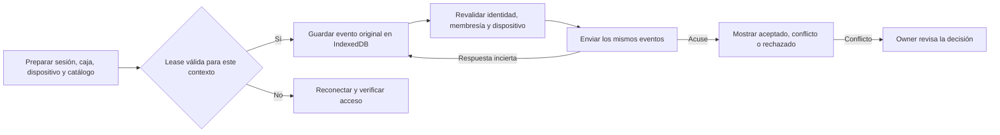

# Contingencia e integraciones

**Corte vigente.** Las etiquetas por UC incorporan [RUN-10](../VALIDATION.md#run-10). La columna de aserciones delimita el escenario ejecutado. Las recetas AS-IS describen el diagnóstico anterior. [Decisiones de diseño](../TO_BE.md).

[Validación RFA2](../VALIDATION.md) · SC-12. E2 identifica la frontera con dobles o pruebas locales. BLOCKED indica una frontera esencial sin evidencia aislada.

PWA usa caché y cola local scoped; un pendiente local no acredita venta ni pago. Los servicios auxiliares se distinguen de endpoints en `DependencyInjection.cs:144–154,240,257–262,292`. Ver el [recorrido propuesto](../TO_BE.md).

## UC-INT-01

GET `/health` · `backend/src/MediPOS.Api/Observability/ObservabilityRegistration.cs:66`. **E2 · IMPLEMENTADO · PASS**. Observabilidad expone liveness. ObservabilityRegistration.cs:66 usa predicado false; no indica PostgreSQL listo. Uso operativo.

## UC-INT-02

GET `/health/ready` · `backend/src/MediPOS.Api/Observability/ObservabilityRegistration.cs:67`. **E3 · IMPLEMENTADO · BLOCKED**. El operador consulta readiness para saber si el host puede atender. ObservabilityRegistration.cs:52,67–72 mapea healthy a 200 y otros a 503. PostgreSqlReadinessCheck.cs:8–19 llama RuntimeDatabaseProbe.cs:15–32 bajo límite, que abre runtime con interceptor y SELECT 1 en transacción read-only. No verifica operaciones de dos tenants ni sustituye prueba RLS.

## UC-INT-03

GET `/api/tenants/{tenantId}/branches/{branchId}/sync/devices` · `backend/src/MediPOS.Api/Tenant/SyncEndpoints.cs:13`. **E2 · IMPLEMENTADO · BLOCKED**. En Contingencia prepara el navegador o consulta dispositivos. workflow.ts:18–32 usa esta lectura para conciliar etiqueta reservada; GetSyncDevicesHandler.cs:16–20 exige sede y revalida contexto. SyncDeviceDirectory aplica tenant/sede y ámbito de actor; se reutiliza dispositivo identificado en lugar de reintentar un alta desconocida.

## UC-INT-04

POST `/api/tenants/{tenantId}/branches/{branchId}/sync/devices` · `backend/src/MediPOS.Api/Tenant/SyncEndpoints.cs:16`. **E3 · IMPLEMENTADO · BLOCKED**. Pulsa preparar contingencia cuando estás en línea. workflow.ts:18–32 reserva etiqueta local; SyncEndpoints.cs:16–20 recibe label y RegisterSyncDeviceHandler (SyncDeviceHandlers.cs:14–24) valida acceso de sucursal y construye dispositivo. SyncStores.cs:19–45 guarda dispositivo y auditoría scoped. 201 identifica el dispositivo; si se perdió, buscar etiqueta reservada antes de generar otra.

## UC-INT-05

POST `/api/tenants/{tenantId}/sync/devices/{deviceId}/revoke` · `backend/src/MediPOS.Api/Tenant/SyncEndpoints.cs:21`. **E3 · IMPLEMENTADO · BLOCKED**. Revoca un dispositivo desde Contingencia. RevokeSyncDeviceHandler (SyncDeviceHandlers.cs:34–48) comprueba identidad/sede y dispositivo, bloquea registro y guarda estado/auditoría en SyncStores.cs:19–45. El cliente conserva marcador de revocación por ámbito y quien no puede reconciliarlo no sincroniza; relee dispositivo original.

## UC-INT-06

POST `/api/tenants/{tenantId}/sync/batches` · `backend/src/MediPOS.Api/Tenant/SyncEndpoints.cs:26`. **E3 · IMPLEMENTADO · BLOCKED**. Al recuperar conexión, sincroniza la cola original de la misma cuenta/sede. workflow.ts:97–117 revalida membresía y conserva sobres al fallar; ProcessOfflineSyncBatchHandler.cs:26–55 valida dispositivo y produce resultado por evento. ReserveSyncEventReceiptHandler.cs:10–33 y SyncStores.cs:48–118 reservan identidad única, recuperan resultado persistido y confirman por evento. El cliente consume acuses sin declarar venta a partir del mero envío.

## UC-INT-07

GET `/api/tenants/{tenantId}/sync/conflicts` · `backend/src/MediPOS.Api/Tenant/SyncEndpoints.cs:33`. **E3 · IMPLEMENTADO · BLOCKED**. Abre Conflictos y aplica filtros. OfflineSaleConflictHandlers.cs:11–25 verifica sede/rol antes y después y restringe a membresía si no es Owner. OfflineSaleConflictStore.cs:25–44 consulta por tenant y filtros y pagina resultados. La lista deja volver al mismo conflicto.

## UC-INT-08

POST `/api/tenants/{tenantId}/sync/conflicts/{conflictId}/resolve` · `backend/src/MediPOS.Api/Tenant/SyncEndpoints.cs:39`. **E3 · IMPLEMENTADO · BLOCKED**. Como Owner abre el conflicto, elige resolución y nota. OfflineSaleConflictHandlers.cs:30–53 revalida rol y membresía después de bloquear; OfflineSaleConflictStore.cs:46–69 guarda decisión y auditoría. Reconsulta el mismo conflicto si falta respuesta. Resolver no crea venta, pago ni movimiento.

## UC-INT-09

GET `/api/tenants/{tenantId}/sync/devices/{deviceId}/catalog/snapshot` · `backend/src/MediPOS.Api/Tenant/SyncEndpoints.cs:45`. **E3 · IMPLEMENTADO · BLOCKED**. Al preparar el navegador, descarga las páginas del snapshot del dispositivo. BranchCatalogHandlers.cs:18–65 exige dispositivo activo en la sede y revalida al terminar; BranchCatalogSyncReader.cs:12–47 abre snapshot RepeatableRead y usa cursor autenticado. Una versión o fecha obsoleta requiere nuevo snapshot y la UI conserva ámbito original.

## UC-INT-10

GET `/api/tenants/{tenantId}/sync/devices/{deviceId}/catalog/changes` · `backend/src/MediPOS.Api/Tenant/SyncEndpoints.cs:51`. **E3 · IMPLEMENTADO · BLOCKED**. Al refrescar catálogo preparado, continúa con el cursor del dispositivo. BranchCatalogHandlers.cs:18–49,67–82 exige vínculo y valida secuencia estricta a través de ventana; BranchCatalogSyncReader.cs:48–58 filtra journal por tenant/sede/versiones. Cursor vencido, hueco o cambio de fecha solicita resync; workflow.ts:41–55 aplica el reinicio de snapshot.

## UC-INT-11

Preparar o bloquear dispositivo PWA. **E2 · IMPLEMENTADO · BLOCKED**. Desde Contingencia, preparar en línea o bloquear localmente. workflow.ts:11–62 comprueba service worker, sesión, acceso y caja propia; obtiene catálogo y calcula lease limitada. storage.ts:20–65 guarda metadatos/catálogo en IndexedDB con scope de usuario, tenant, sede y membresía, nonce y vencimiento. Bloquear impide usar lease; no mezcla las ventas en cola de otra cuenta.

## UC-INT-12

Encolar venta local, retomar y conciliar. **E3 · IMPLEMENTADO · BLOCKED**. Registra venta provisional offline y luego sincroniza desde la misma identidad. workflow.ts:83–117 serializa evento v1 con UUID y hash y revalida acceso al reconectar; storage.ts:71–110 guarda sobre, acuses por scope, diferimiento y estados. Procesar un rechazo o conflicto no lo vuelve venta confirmada. Reabrir conserva el evento original y aplica UC-INT-06.

## UC-INT-13

Procesar catálogo oficial DIGEMID. **E3 · NO_EXPUESTO · BLOCKED**. No hay pantalla ni ruta pública para abastecer catálogo oficial. Los servicios internos aplican autoridad oficial y separan staging, curación, publicación y refresh. OfficialCatalogConfigurations.cs:12,44 mapea lotes/filas, OfficialCatalogCurationConfigurations.cs:14,44,63,84 mapea propuestas/revisiones/publicación/auditoría y OfficialCatalogRefreshConfigurations.cs:15,54 versiona refresh e historial. Revisar procedencia/estado del lote antes de publicar; el directorio global visible es otro flujo.

## UC-INT-14

Importar UBL de proveedor. **E3 · NO_EXPUESTO · BLOCKED**. No hay acción UBL en Compras expuesta. Los handlers internos ImportSupplierUblInvoiceHandler, ReviewSupplierUblImportHandler y ConvertSupplierUblImportToPurchaseDraftHandler validan acceso, revisan líneas y convierten con ExpectedVersion. SupplierUblConfigurations.cs:25,56,83 mapea importación, líneas y vínculos; SupplierUblImportStore.cs:89 y siguientes guarda conversión a borrador, sin confirmar stock. Consultar importación/versión antes de repetir conversión.

## UC-INT-15

Entrega CPE y consultas de proveedor. **E3 · DESACTIVADO · BLOCKED**. RunElectronicDocumentDelivery y work store existen (DependencyInjection.cs:257–262). Identidad de entrega registrada como DisabledElectronicDeliveryIdentity. No se encontró endpoint CPE o job alojado en el inventario. Fuente efectiva de configuración del entorno no inspeccionada.

## UC-INT-16

Comprobar conexión local de plataforma. **E1 · IMPLEMENTADO · NOT_RUN**. Al arrancar plataforma en Development local, verificar entorno antes de ofrecer rutas. LocalDevelopmentPlatform.cs:28–59 limita host/puerto/base local y registra guard; :71–82 exige que RuntimeDatabaseProbe responda en el plazo. RuntimeDatabaseRoleInterceptor.cs:14–44 rechaza rol con privilegios incompatibles. Un fallo impide startup del modo; no mide acceso comercial.

## UC-INT-17

Recuperación y respaldo CLI. **E3 · IMPLEMENTADO · BLOCKED**. Operador ejecuta backup, verifica archivo, prepara migraciones offline o restaura/ensaya en destino autorizado. Program.cs:26–52,82–90 requiere configuración privada y confirmación concreta. RecoveryWorkflow.cs:15–71 verifica archivo/manifiesto y :83–125 restaura, compara integridad y registra cobertura; un resultado backup distingue archivo verificado de restauración ejecutada. No reintentar sobre destino incierto sin verificar identidad/estado.

## UC-INT-18

Servir SPA y caché offline. **E2 · IMPLEMENTADO · BLOCKED**. Abre la aplicación en el origen configurado, luego accede a contingencia si hay lease válida. Program.cs:60–63 selecciona hosting y PublishedFrontend.cs:8–32 exige HTTPS/origen y separa API. frontend/build/pwa.ts:7–17 almacena shell y assets para navegación sin conexión, elimina versiones antiguas y no cachea endpoints. Sesión y cola siguen los flujos ACC e INT; fallback visual no autoriza operaciones.

## Venta provisional y conciliación

## Fuentes

- [DependencyInjection.cs](../../../../backend/src/MediPOS.Infrastructure/DependencyInjection.cs)
- [ObservabilityRegistration.cs](../../../../backend/src/MediPOS.Api/Observability/ObservabilityRegistration.cs)
- [SyncEndpoints.cs](../../../../backend/src/MediPOS.Api/Tenant/SyncEndpoints.cs)
- [workflow.ts](../../../../frontend/src/features/offline/workflow.ts)
- [ProcessOfflineSyncBatchHandler.cs](../../../../backend/src/MediPOS.Application/Modules/OfflineSync/ProcessOfflineSyncBatchHandler.cs)
- [OfficialCatalogServices.cs](../../../../backend/src/MediPOS.Infrastructure/Modules/Catalog/OfficialImport/OfficialCatalogServices.cs)
- [LocalDevelopmentPlatform.cs](../../../../backend/src/MediPOS.Api/Authentication/LocalDevelopmentPlatform.cs)
- [PublishedFrontend.cs](../../../../backend/src/MediPOS.Api/Hosting/PublishedFrontend.cs)
- [Prueba relacionada de la familia](../../../../backend/tests/MediPOS.UnitTests/Api/OfflineSyncBatchHttpContractsTests.cs) · E0 de ejecución, se inventaría por contexto; no atribuir cobertura de todas las variantes.
